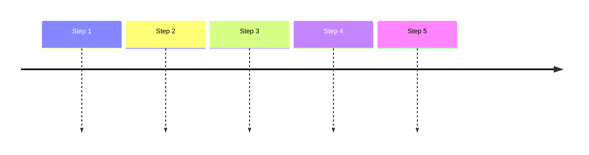
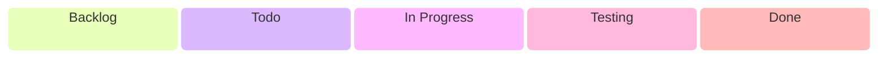

<h1 align="center"> 🎴 nodeck 🎴 </h1>

<p align="center">
  
  
  
</p>
<p align="center">
  
  
  
  
  
  
  
  
</p>

Nodeck is a card-centered gallery for organizing media, comics, sets, tags, and decks. Cards represent content; tags and sources are reusable catalog entries. Decks collect references to cards without duplicating them.

## Overview

The backend exposes an ASP.NET Core Minimal API powered by .NET 9 and MySQL. The frontend uses React 18, Vite, Tailwind CSS, and shadcn/ui. Existing tag and source cards remain in the database during migration, while new entries use dedicated catalog tables.

## Features

- Card gallery for browsing saved objects.
- Reusable tags and sources that can be assigned to content cards.
- Comics and sets with ordered child media; decks can reference cards from anywhere in the library.
- Card pages record a view after two uninterrupted seconds of visible, loaded media or playing video. They also offer a daily Up, Neutral, or Down vote, separate from Favorites.
- Media uploads recognize JPEG, PNG, WebP, GIF, MP4, MOV, and WebM from file content. The original is retained; video that fails the current browser compatibility check also gets an H.264/AAC MP4 playback copy.
- GIF and video uploads generate a short animated preview and a still poster. The edit page lets you choose the preview start time or reset it to automatic selection.
- MySQL-backed storage for cards, tags, decks, and related gallery data.
- Minimal API backend with a compact, predictable HTTP surface.
- Docker Compose setup with the backend and database running in separate containers.
- React 18 frontend optimized for fast gallery navigation.
- shadcn/ui component setup for simple, consistent interface building.
- Tailwind CSS 4 styling pipeline integrated through Vite.
- Vite development workflow with quick reloads.

## Screenshots

<table>
  <tr>
    <td></td>
    <td></td>
  </tr>
</table>

## Installation

1. Install the required SDKs and tooling:
   - .NET 9 SDK;
   - Node.js with npm;
   - Docker and Docker Compose.

2. Clone the repository:

```bash
git clone https://github.com/TimCixo/nodeck.git
cd nodeck
```

3. Restore backend and frontend dependencies from their project directories when developing outside containers.

```bash
dotnet restore
npm install
```

4. Create a `.env` file for Docker Compose and MySQL settings.

```bash
cp .env.example .env
```

## Usage

<p align="center">
  
</p>

Run the composed project so the backend API starts in one container and MySQL starts in another. The frontend can be served separately by Vite during development or added to the compose file as the project grows.

Typical container workflow:

```bash
docker compose up --build
```

Typical frontend workflow:

```bash
npm run dev
```

The frontend uses `http://localhost:5080` for the API by default, matching `.env.example`. If you choose another `BACKEND_HTTP_PORT`, start Vite with `VITE_API_BASE_URL=http://localhost:YOUR_PORT npm run dev`. A fresh copy may include `.gitkeep` files under `volumes/app_data`; these are empty directory placeholders and do not require a migration backup.

Open the Vite URL in a browser. Create media, comic, or set cards; add reusable tags and sources from a card page; organize cards in decks.

Use **Bulk import** in the Create menu (`/cards/import`) to select or drop a mixed batch of JPEG, PNG, WebP, GIF, MP4, MOV, and WebM files. Each file starts as a standalone media card with a title taken from its filename; edit the title before uploading. Optionally assign files to a comic or set group, give the group a title, and move its files up or down before uploading. Before importing, search for existing tags and select any number, plus one existing source with an optional original URL for the batch. The choice locks when the first import starts and is assigned to each created media card and each created comic or set group card. **Upload / retry** creates media cards one at a time, then creates or updates each group; first creation waits until all files assigned to that group are uploaded and requires at least two. The page shows each file's queued, uploading, created, error, or needs review state, links to created cards, group errors, and counts of total, uploaded, upload errors, needs review, and pending files. **Pause after current request** stops before the next request; it lets the request already in flight finish and does not abort it. Use **Upload / retry** to continue: created card IDs and completed tag/source steps on media and group cards are retained, while remaining steps are retried. Tag/source assignment has its own status and errors, separate from upload errors. After a media card is created, the page checks its image analysis status every five seconds, with at most four checks in flight, until it is done or failed; use **Refresh analysis** to check manually. Analysis status, retry details, and analysis check errors appear separately from upload errors. Files matching a queued name, size, and modified time are added with a possible duplicate warning for review. For new bulk-import rows, the browser stores a stable creation key in the local draft before each media or group creation POST. After a network or server error, **Upload / retry** checks the server's creation-request lookup with that key before sending the same request again. A matching completed request returns the existing card; a missing result can be retried with the same key. The original file is still needed to resend a media POST. Older keyless draft rows retain the manual review flow: check the gallery and enter an existing ID to reconcile it. That check compares media type, original name and size, or a group's type and ordered child IDs; it does not prove whole-file identity. Retrying a keyless creation POST can create a duplicate. The browser saves queue details, catalog choices, created IDs, and retry state in localStorage, but not file bytes. After a reload, reselect missing files: a unique match of name, size, modified time, type, and a sampled SHA-256 fingerprint can reattach from a batch selection; ambiguous or older rows without a fingerprint need the per-row **Attach file to this row** control. The fingerprint covers the first and last 64 KiB, so it does not prove whole-file identity. An interrupted keyed POST is checked by its saved key on retry; an interrupted older keyless POST returns as needs review before another POST. **Clear local draft** asks for confirmation and removes the local queue only; cards already created on the server remain. If browser storage cannot save the recovery marker, the create POST is not sent; free storage and retry. Browser storage can be unavailable or full. The creation key survives a reload with the local draft, so keyed creation requests can be reconciled across browser sessions. The queue itself remains local; there is no persistent server batch or background import queue.

The API accepts an optional `Idempotency-Key` header containing a canonical lowercase UUID on `POST /api/cards` for `media` and on `POST /api/cards/collections` for a comic or set built from existing cards. Omit it for the legacy keyless behavior; keyed multipart creation of a comic or set is unsupported. The server compares a SHA-256 request hash: media includes the complete uploaded file, filename, size, type, title, properties, and relations; collection creation includes its type, normalized title, and ordered child IDs. The first creation returns `201`, an identical replay returns `200` with the existing card, and reuse with a changed request returns `409`. If the created card was deleted, its key remains as a tombstone and returns `410`. A temporary database lock conflict returns `425`; retry later with the same key. `GET /api/cards/creation-requests/{scope}/{key}` uses `media` or `collection` and returns `200` with the card, `404` for an unknown key, or `410` for a deleted card. Invalid scope or noncanonical key returns `400`.

The Home page has **Recently added**, **Recommended**, and **Today's picks** rails. **Today's picks** loads a server-generated selection for the browser's IANA time zone and shows the first 12 of up to 30 cards. The rails link to **View all** pages: `/feed/daily` shows up to 30 daily picks, while `/feed/recommended` shows up to 50 recommendations with a **Collections**/**Pages** switch. These pages have fixed result limits, not pagination. The daily selection refreshes after local midnight. Use the mobile navigation menu on narrow screens. Submitting the header search opens the gallery with that query.

In the gallery, search cards by title or ID and combine the search with tag and source filters. The search and selected catalog filters stay in the gallery URL. The gallery shows loading, empty-result, and error messages.

On a deck page, switch between grid and brick views. Cards appear in deck order with captions showing position, type, ID, and title; expand **Membership properties** on a card when present. Deck properties and metadata are under **Technical details**.

On a card page, open **Decks** to add the card to or remove it from regular decks without editing the deck form. A card can belong to multiple decks. **Remove from deck** on a deck page removes only that membership; the card and its other deck memberships remain. The API exposes non-system memberships through `GET /api/cards/{cardId}/decks` and adds or removes a link idempotently through `PUT` or `DELETE /api/decks/{deckId}/cards/{cardId}`.

On a comic card, the reader starts in **Single page** mode. Use **Previous**/**Next**, choose a page from the thumbnail strip, press Left/Right while the reader has focus, or swipe horizontally on the page to move through it. Select **Long scroll** to view all pages in order. Click a displayed page to open its child card.

At the bottom of a media, comic, or set card, the **Recommended** rail uses that card as context. Switch between **Collections**, which groups child pages under their comic or set, and **Pages**, which can show individual pages. Scroll the rails horizontally by touch, trackpad, or their arrow buttons.

Video and GIF processing requires `ffmpeg` and `ffprobe`. The backend Docker image includes them; install FFmpeg separately when running the backend outside Docker. Video transcoding runs during the upload request with a 10-minute timeout, so an incompatible video may take longer to save. The card API keeps `contentUrl` for the original and supplies `playbackUrl` when it creates a playback copy; the card page uses that copy for playback and links to the original file.

For GIF and video, automatic preview selection samples up to ten points across the file and generates an animation of up to about three seconds with a poster. The card API exposes `posterUrl`; the video viewer uses it before playback. On the media edit page, use the Preview start slider or seconds field and **Save preview** to regenerate both files at that point. **Reset to automatic** selects a new start automatically. The API equivalent is `PUT /api/cards/{id}/preview` with `{ "startSeconds": 12.5 }`, or `null` to reset. GIF metadata is read without decoding all frames and frames above 16,777,216 pixels are rejected. Selection quality has not yet been measured on real anime and realistic media.

## Interest signals

On a media, comic, or set page, a view is recorded once per opening after two uninterrupted seconds with loaded content meaningfully visible in the viewport; video must be playing. Switching tabs, scrolling content out of view, or pausing video interrupts the timer. `POST /api/cards/{id}/views` accepts a UUID `eventId` and `durationMs` from 2,000 to 600,000; repeating an event ID does not create another view. The library retains the most recent 500 view events.

The card page also offers **Up** (`+1`), **Neutral** (`0`), and **Down** (`-1`). `GET /api/cards/{id}/vote?timeZone=Europe/Kyiv` reads today's vote; `PUT /api/cards/{id}/vote` accepts `{ "value": 1, "timeZone": "Europe/Kyiv" }` and can replace today's choice. The browser supplies its IANA time zone; the server derives the local date from its own clock. A new date allows a new vote. An unset vote has a `null` value. Favorites remain a separate action and are not changed by votes. These signals apply to one local library, without individual viewer accounts.

`GET /api/recommendations` returns ranked cards and scores. Use `mode=collections` (the default) or `mode=pages`, `limit` from 1 to 50 (default 20), and optional `contextCardId` for related cards. Ranking draws on views from the last 30 days, daily votes from the last 90 days, and assigned tags. A freshness bonus of at most 2 points favors newer cards, including when there is no interest history. During selection, the first related follow-up is unpenalized; starting with the third card sharing an assigned tag, each further repetition incurs a 4-point penalty. The response score is the card's score at selection, after this penalty. Equal scores favor the higher card ID. A card's latest negative vote excludes it from recommendations. The collections mode folds child pages into their parent; pages mode can show individual pages, capped at three per comic or set. Ranking uses one UTC instant per request for its time windows, signal decay, and freshness. Recommendation quality has not been calibrated on a real library; visual embeddings are not implemented.

In collections mode, up to three strongest child signal weights contribute to a parent, so longer comics and sets do not gain a score merely from having more pages. `GET /api/recommendations/daily?timeZone=Europe/Kyiv&limit=30` accepts an IANA time zone and a limit from 1 to 50 (default 30), returning `{items, localDate, timeZone}`. The server orders eligible top-level cards deterministically by local date, time zone, and card ID. Cards created on the current local day cannot change an established selection; a library with no older cards can show its first day's cards. Deleted cards and cards whose latest vote is `-1`, including a negative vote on a child, are excluded. The daily selection is not a saved deck. The recommended feed draws from bounded candidate pools, including up to 200 newest top-level cards, and does not provide pagination.

Both recommendation endpoints check stored files before returning a card. Media needs a readable original and, when its metadata declares a playback file path, a readable playback copy; a JSON `null` playback path needs no copy. A comic or set needs a readable cover preview and at least one readable child media file. Missing, unreadable, and paths that resolve lexically outside the storage root fail the check. The daily endpoint scans its deterministic order in pages of 100, up to 5,000 candidates per mode, filling result slots with readable cards; it considers today's uploads only if no older readable card is found. Child checks scan at most 10,000 rows per batch of 100 collections. These caps can leave a result short of its requested limit even when readable cards exist beyond them. If a preview URL fails in the browser, its tile shows the card type instead.

## Danbooru tag vocabulary (optional full import)

The WD label seed in the next section is enough to start image tagging. To add the complete Danbooru tag and alias vocabulary later, use a contactable User-Agent. Keep MySQL running; the import command starts a one-off backend container and does not start the API server:

```bash
docker compose up -d mysql
docker compose run --rm -e NODECK_DANBOORU_USER_AGENT='nodeck/1.0 (contact: you@example.com)' backend import-danbooru-tags
```

The importer fetches tags before aliases, maps Danbooru categories to general, artist, copyright, character, and meta, and preserves local tags and assignments when names collide. It reports conflicts per page. Each completed page saves its cursor in MySQL, so rerun the same command after an interruption. `--max-pages N` limits a run for an initial trial; a later run resumes. `--refresh` starts a complete pass over an already finished import to pick up changes from Danbooru. Use it once, then resume without `--refresh` if interrupted. The importer limits requests to about one per second and retries temporary server errors. The API and gallery remain usable while the vocabulary is imported, but importing a large dictionary can take time.

Tag proposals have their own database records until accepted. On a card page, pending proposals show confidence and accept/reject controls; accepted tags record `assignmentSource: "confirmed"`, while tags added directly record `"manual"`. Reanalysis updates only pending proposals, and removing a tag records a rejection so the same proposal does not return. The API reads pending proposals at `GET /api/cards/{id}/tag-suggestions` and records decisions at `PUT /api/cards/{id}/tag-suggestions/{tagId}/decision` with `{ "decision": "accepted" }` or `"rejected"`.

## Local image tagging

Install the pinned [WD ViT Tagger v3](https://huggingface.co/SmilingWolf/wd-vit-tagger-v3) ONNX model and labels into the backend data volume, then seed its general and character Danbooru tags from `selected_tags.csv`. The script checks both SHA-256 hashes. The model is about 362 MB; it runs locally on CPU. After the normal `docker compose up --build` setup, run:

```bash
scripts/install-wd-tagger.sh
docker compose run --rm backend seed-wd-tags
```

The seed is safe to rerun: it preserves existing tags, reports name or ID conflicts, and records readiness separately from the complete Danbooru import. The running backend then processes queued image jobs automatically; a full Danbooru import can follow later. The model and labels persist in `volumes/app_data/`, and the seeded catalog persists in MySQL under `volumes/mysql_data/`. Keep these data directories out of Git; the seed needs no Danbooru User-Agent. Speech recognition has its own setup below, unchanged by this step.

Once the model is installed and either the WD seed or the full Danbooru tag import is complete, the backend automatically analyzes newly uploaded or replaced JPEG, PNG, WebP, GIF, MP4, MOV, and WebM media cards, including pages added to a comic or set. Static images use their preview; GIF and video use up to 30 baseline frames sampled across ten parts of the original file, plus up to ten frames probed between visibly different parts. The optional scene probes have a 15-second budget and are kept only when distinct from both neighboring baseline frames. Repeated frames reuse one inference, and tags are combined by peak confidence and appearances in different parts. MySQL stores each job so a restart does not discard it. The worker runs one analysis at a time, retries failures up to five times, and discards results when the media was replaced during analysis. Pending proposals can then be reviewed on the card page. `GET /api/cards/{id}/analysis` shows a job's state, attempt count, next attempt time, and last error; a card without an analysis job returns 404.

To analyze an older media card, run `docker compose run --rm backend analyze-card 123`, replacing `123` with its ID. Existing cards are not queued automatically by the schema upgrade, avoiding a sudden full-library CPU load. The model submits up to 40 general or character tag proposals matched by Danbooru ID. Custom tag similarity and calibration on anime and realistic samples remain separate work. The model and labels are stored under `volumes/app_data/models/wd-vit-tagger-v3/`. Set `NODECK_TAGGER_MODEL_DIR` to use another model directory.

## Local speech recognition

Install the pinned multilingual Whisper base and Silero VAD models, then build the backend with its bundled [whisper.cpp v1.9.5](https://github.com/ggml-org/whisper.cpp/releases/tag/v1.9.5) CLI:

```bash
scripts/install-whisper-models.sh
docker compose up -d --build backend
```

New or replaced videos with an audio stream receive a separate speech job. The worker reads up to ten minutes of the original video's audio, converts it to mono 16 kHz WAV, runs locally on two CPU threads, and renews its database lease during recognition. Jobs retry up to five times. `GET /api/cards/{id}/speech-analysis` returns the job state, detected language, processed duration, truncation flag, and separate speech and English-speech flags; it returns 404 when no job exists. A silent audio stream does not count as English speech: empty or inconclusive recognition leaves the flags and language `null`. Existing videos are not queued by migration 7.

When English speech is detected, the worker checks exact phrases of two to four English words against existing tag names and aliases. Eligible tags are Danbooru `general` tags or custom tags previously assigned manually or confirmed on any card. It can submit up to ten pending speech proposals with a heuristic confidence of at most `0.72`; this score has not been calibrated on real media. Negated or quoted phrases and nearby mentions of tag terminology are excluded conservatively, so some spoken matches may be missed. Matching does not infer general semantic similarity or create tags from transcript words. The transcript remains transient: proposals store tag IDs, scores, and a model key; match evidence stores tag IDs, a rule ID, and numeric segment start/end times. Transcript text is not stored in MySQL or returned by the API. Reanalysis replaces pending speech proposals while preserving accepted, rejected, and manually assigned tags. A pending visual proposal for the same card and tag takes precedence over a speech proposal; visual reanalysis can replace a pending speech proposal. Accuracy on real media remains to be measured.

The installer verifies SHA-256 hashes and stores models under `volumes/app_data/models/whisper/`; keep them out of Git. Set `NODECK_WHISPER_MODEL_DIR` for another directory and `NODECK_WHISPER_CLI` for another CLI path. An absent or invalid model leaves jobs pending without consuming their attempts. Recognition has a 20-minute process limit and may be slow on CPUs; videos longer than ten minutes are marked `truncated` because only their first ten minutes are analyzed.

## Database upgrades and recovery

Schema changes are recorded in `schema_migrations` and run once, in order, while the API holds a migration lock. A populated library will not upgrade until a matching backup is available. The API checks its database name, schema version, row counts, app file count, and both backup checksums before changing the schema. MySQL schema changes cannot be rolled back as one transaction, so a failed upgrade must be restored from backup while the backend is stopped.

Migration 7 creates a separate durable speech-analysis job table for video audio. New or replaced videos with an audio stream receive a pending speech job; replacing one with silent media removes that job. Existing cards are not queued by the migration. A backup for this migration must be created with the updated backup script so its manifest includes the speech-job row count.

Migration 8 adds `suggestion_source` to tag proposals with `visual` as the default for existing rows. It distinguishes visual and speech proposals while keeping prior decisions intact.

Migration 9 creates separate `card_view_events` and `card_daily_votes` tables. The updated backup script includes both tables' row counts in its manifest, which the API verifies before a populated-library upgrade.

Migration 10 adds `card_creation_requests` to retain keyed creation results and deleted-card tombstones. The backup script records `count.card_creation_requests` in its manifest; the migration check accepts a missing count only for backups made before version 10, when the table did not exist. Create a current backup before upgrading a populated library.

Before upgrading an existing library, keep MySQL running and create a backup from the project root:

```bash
scripts/library-backup.sh backup ./backups
```

The command stops the backend, writes `database.sql`, `app_data.tar`, and `manifest.txt` into a new timestamped directory, and leaves the backend stopped. Add the generated directory name to `.env` (do not commit `.env`):

```dotenv
NODECK_MIGRATION_BACKUP_DIR=./backups
NODECK_MIGRATION_BACKUP_MANIFEST=/app/migration-backup/nodeck-YYYYMMDDTHHMMSSZ-XXXXXXXX/manifest.txt
```

Then start the updated backend with `docker compose up -d --build backend`. For an installation running the backend outside Docker, set `NODECK_MIGRATION_BACKUP_MANIFEST` to the host's absolute manifest path. A fresh empty database needs no backup acknowledgement. The backup script also works after a schema version is already installed, when preparing for a later upgrade.

If the upgrade fails, keep the backend stopped and restore the same snapshot:

```bash
scripts/library-backup.sh restore ./backups/nodeck-YYYYMMDDTHHMMSSZ-XXXXXXXX --confirm-restore
```

The restore command verifies both archives, replaces the configured database, and moves the current `volumes/app_data` aside before installing the saved files. Review the error before starting the API again; use the previous application version or fix the migration first. Do not resume writes between taking the backup and completing the upgrade.

## Project Structure

```text
nodeck/
├── docker-compose.yml
├── .env
│
├── backend/
│   ├── Dockerfile
│   ├── MyApp.Api.csproj
│   ├── Program.cs
│   ├── appsettings.json
│   └── src/
│
├── frontend/
│   ├── components.json
│   ├── package.json
│   ├── vite.config.ts
│   ├── index.html
│   └── src/
│       ├── components/
│       │   └── ui/
│       ├── lib/
│       └── index.css
│
└── volumes/
    ├── app_data/
    │   ├── config/
    │   ├── uploads/
    │   ├── cache/
    │   ├── cards/
    │   └── user-data/
    │
    └── mysql_data/
        └── /var/lib/mysql
```

## Configuration

The backend should keep application settings in the standard ASP.NET Core configuration files and environment variables. MySQL connection settings should be provided through `.env` and passed into the backend container by Docker Compose.

The MySQL container should store database files in `volumes/mysql_data`, while application files such as uploads, cache, generated card assets, and user data should live under `volumes/app_data`.

The frontend should keep Vite configuration in the frontend project and use an environment variable for the API base URL when the backend address differs from the default development setup.

shadcn/ui is configured through `frontend/components.json`. Shared UI primitives live in `frontend/src/components/ui`, shared helpers live in `frontend/src/lib`, and the `@` import alias points to `frontend/src`.

## Development

- Backend: ASP.NET Core Minimal API on .NET 9.
- Database: MySQL in a dedicated Docker container.
- Runtime: backend container composed together with the MySQL container.
- Frontend: React 18 with Vite.
- UI: shadcn/ui components on top of Tailwind CSS 4.
- UI model: media, comics, and sets are cards; tags and sources are catalog entries; decks contain card references.

Recommended development flow:

1. Start the composed backend and MySQL services.
2. Start the Vite dev server.
3. Build interface pieces from shadcn/ui primitives in `frontend/src/components/ui`.
4. Update card, tag, or deck behavior in small increments.
5. Keep API contracts and UI state aligned when changing gallery data models.

## Roadmap



## Development Board



## Contributing

Contributions are welcome.

You can help by:
- reporting bugs;
- suggesting new features;
- improving documentation;
- testing the gallery with different card, tag, and deck structures;
- submitting pull requests.

Before making large changes, please open an issue first to discuss the idea.

## License

This project is licensed under the terms of the license included in the repository.

See the LICENSE file for details.

## Credits

Created by [TimCixo](https://github.com/TimCixo).

Built as a card-first gallery for collecting, tagging, and arranging visual objects into decks.
