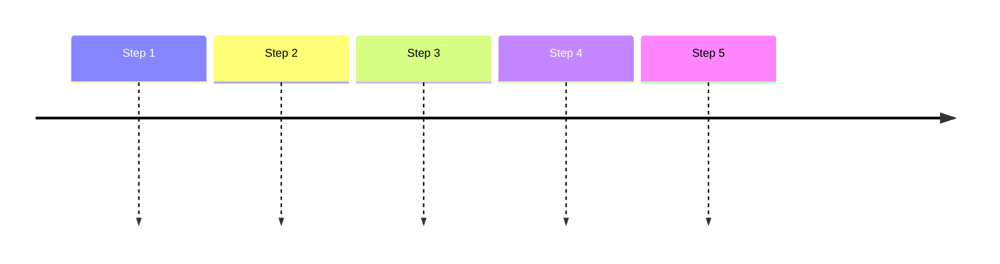
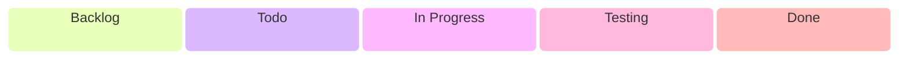

<h1 align="center"> 🎴 nodeck 🎴 </h1>

<p align="center">
  
  
  
</p>
<p align="center">
  
  
  
  
  
  
  
  
</p>

Nodeck is a card-centered gallery for organizing media, comics, sets, tags, and decks. Cards represent content; tags and sources are reusable catalog entries. Decks collect references to cards without duplicating them.

## Overview

The backend exposes an ASP.NET Core Minimal API powered by .NET 9 and MySQL. The frontend uses React 18, Vite, Tailwind CSS, and shadcn/ui. Existing tag and source cards remain in the database during migration, while new entries use dedicated catalog tables.

## Features

- Card gallery for browsing saved objects.
- Reusable tags and sources that can be assigned to content cards.
- Comics and sets with ordered child media; decks can reference cards from anywhere in the library.
- Media uploads recognize JPEG, PNG, WebP, GIF, MP4, MOV, and WebM from file content. The original is retained; video that fails the current browser compatibility check also gets an H.264/AAC MP4 playback copy.
- GIF and video uploads generate a short animated preview and a still poster. The edit page lets you choose the preview start time or reset it to automatic selection.
- MySQL-backed storage for cards, tags, decks, and related gallery data.
- Minimal API backend with a compact, predictable HTTP surface.
- Docker Compose setup with the backend and database running in separate containers.
- React 18 frontend optimized for fast gallery navigation.
- shadcn/ui component setup for simple, consistent interface building.
- Tailwind CSS 4 styling pipeline integrated through Vite.
- Vite development workflow with quick reloads.

## Screenshots

<table>
  <tr>
    <td></td>
    <td></td>
  </tr>
</table>

## Installation

1. Install the required SDKs and tooling:
   - .NET 9 SDK;
   - Node.js with npm;
   - Docker and Docker Compose.

2. Clone the repository:

```bash
git clone https://github.com/TimCixo/nodeck.git
cd nodeck
```

3. Restore backend and frontend dependencies from their project directories when developing outside containers.

```bash
dotnet restore
npm install
```

4. Create a `.env` file for Docker Compose and MySQL settings.

```bash
cp .env.example .env
```

## Usage

<p align="center">
  
</p>

Run the composed project so the backend API starts in one container and MySQL starts in another. The frontend can be served separately by Vite during development or added to the compose file as the project grows.

Typical container workflow:

```bash
docker compose up --build
```

Typical frontend workflow:

```bash
npm run dev
```

Open the Vite URL in a browser. Create media, comic, or set cards; add reusable tags and sources from a card page; organize cards in decks.

Video and GIF processing requires `ffmpeg` and `ffprobe`. The backend Docker image includes them; install FFmpeg separately when running the backend outside Docker. Video transcoding runs during the upload request with a 10-minute timeout, so an incompatible video may take longer to save. The card API keeps `contentUrl` for the original and supplies `playbackUrl` when it creates a playback copy; the card page uses that copy for playback and links to the original file.

For GIF and video, automatic preview selection samples up to ten points across the file and generates an animation of up to about three seconds with a poster. The card API exposes `posterUrl`; the video viewer uses it before playback. On the media edit page, use the Preview start slider or seconds field and **Save preview** to regenerate both files at that point. **Reset to automatic** selects a new start automatically. The API equivalent is `PUT /api/cards/{id}/preview` with `{ "startSeconds": 12.5 }`, or `null` to reset. GIF metadata is read without decoding all frames and frames above 16,777,216 pixels are rejected. Selection quality has not yet been measured on real anime and realistic media.

## Danbooru tag vocabulary

After the database upgrade, import the reusable Danbooru tags and aliases with a contactable User-Agent. Keep MySQL running; the import command starts a one-off backend container and does not start the API server:

```bash
docker compose up -d mysql
docker compose run --rm -e NODECK_DANBOORU_USER_AGENT='nodeck/1.0 (contact: you@example.com)' backend import-danbooru-tags
```

The importer fetches tags before aliases, maps Danbooru categories to general, artist, copyright, character, and meta, and preserves local tags and assignments when names collide. It reports conflicts per page. Each completed page saves its cursor in MySQL, so rerun the same command after an interruption. `--max-pages N` limits a run for an initial trial; a later run resumes. `--refresh` starts a complete pass over an already finished import to pick up changes from Danbooru. Use it once, then resume without `--refresh` if interrupted. The importer limits requests to about one per second and retries temporary server errors. The API and gallery remain usable while the vocabulary is imported, but importing a large dictionary can take time.

Tag proposals have their own database records until accepted. On a card page, pending proposals show confidence and accept/reject controls; accepted tags record `assignmentSource: "confirmed"`, while tags added directly record `"manual"`. Reanalysis updates only pending proposals, and removing a tag records a rejection so the same proposal does not return. The API reads pending proposals at `GET /api/cards/{id}/tag-suggestions` and records decisions at `PUT /api/cards/{id}/tag-suggestions/{tagId}/decision` with `{ "decision": "accepted" }` or `"rejected"`.

## Local image tagging (first analysis slice)

Install the pinned [WD ViT Tagger v3](https://huggingface.co/SmilingWolf/wd-vit-tagger-v3) ONNX model and labels into the backend data volume. The script checks both SHA-256 hashes. The model is about 362 MB; it runs locally on CPU. Import Danbooru tags first, since proposals reference entries in that catalog.

```bash
scripts/install-wd-tagger.sh
docker compose run --rm backend analyze-card 123
```

Replace `123` with the ID of an already uploaded static JPEG, PNG, or WebP media card. The command analyzes its preview, matches model tag IDs to imported Danbooru IDs, and submits up to 40 general or character tag proposals for review on the card page. It does not automatically run on upload yet. GIF/video analysis, speech analysis, custom tag similarity, and calibration on anime and realistic samples remain separate work. The model and labels are stored under `volumes/app_data/models/wd-vit-tagger-v3/` and must stay out of Git. Set `NODECK_TAGGER_MODEL_DIR` to use another model directory.

## Database upgrades and recovery

Schema changes are recorded in `schema_migrations` and run once, in order, while the API holds a migration lock. A populated library will not upgrade until a matching backup is available. The API checks its database name, schema version, row counts, app file count, and both backup checksums before changing the schema. MySQL schema changes cannot be rolled back as one transaction, so a failed upgrade must be restored from backup while the backend is stopped.

Before upgrading an existing library, keep MySQL running and create a backup from the project root:

```bash
scripts/library-backup.sh backup ./backups
```

The command stops the backend, writes `database.sql`, `app_data.tar`, and `manifest.txt` into a new timestamped directory, and leaves the backend stopped. Add the generated directory name to `.env` (do not commit `.env`):

```dotenv
NODECK_MIGRATION_BACKUP_DIR=./backups
NODECK_MIGRATION_BACKUP_MANIFEST=/app/migration-backup/nodeck-YYYYMMDDTHHMMSSZ-XXXXXXXX/manifest.txt
```

Then start the updated backend with `docker compose up -d --build backend`. For an installation running the backend outside Docker, set `NODECK_MIGRATION_BACKUP_MANIFEST` to the host's absolute manifest path. A fresh empty database needs no backup acknowledgement. The backup script also works after a schema version is already installed, when preparing for a later upgrade.

If the upgrade fails, keep the backend stopped and restore the same snapshot:

```bash
scripts/library-backup.sh restore ./backups/nodeck-YYYYMMDDTHHMMSSZ-XXXXXXXX --confirm-restore
```

The restore command verifies both archives, replaces the configured database, and moves the current `volumes/app_data` aside before installing the saved files. Review the error before starting the API again; use the previous application version or fix the migration first. Do not resume writes between taking the backup and completing the upgrade.

## Project Structure

```text
nodeck/
├── docker-compose.yml
├── .env
│
├── backend/
│   ├── Dockerfile
│   ├── MyApp.Api.csproj
│   ├── Program.cs
│   ├── appsettings.json
│   └── src/
│
├── frontend/
│   ├── components.json
│   ├── package.json
│   ├── vite.config.ts
│   ├── index.html
│   └── src/
│       ├── components/
│       │   └── ui/
│       ├── lib/
│       └── index.css
│
└── volumes/
    ├── app_data/
    │   ├── config/
    │   ├── uploads/
    │   ├── cache/
    │   ├── cards/
    │   └── user-data/
    │
    └── mysql_data/
        └── /var/lib/mysql
```

## Configuration

The backend should keep application settings in the standard ASP.NET Core configuration files and environment variables. MySQL connection settings should be provided through `.env` and passed into the backend container by Docker Compose.

The MySQL container should store database files in `volumes/mysql_data`, while application files such as uploads, cache, generated card assets, and user data should live under `volumes/app_data`.

The frontend should keep Vite configuration in the frontend project and use an environment variable for the API base URL when the backend address differs from the default development setup.

shadcn/ui is configured through `frontend/components.json`. Shared UI primitives live in `frontend/src/components/ui`, shared helpers live in `frontend/src/lib`, and the `@` import alias points to `frontend/src`.

## Development

- Backend: ASP.NET Core Minimal API on .NET 9.
- Database: MySQL in a dedicated Docker container.
- Runtime: backend container composed together with the MySQL container.
- Frontend: React 18 with Vite.
- UI: shadcn/ui components on top of Tailwind CSS 4.
- UI model: media, comics, and sets are cards; tags and sources are catalog entries; decks contain card references.

Recommended development flow:

1. Start the composed backend and MySQL services.
2. Start the Vite dev server.
3. Build interface pieces from shadcn/ui primitives in `frontend/src/components/ui`.
4. Update card, tag, or deck behavior in small increments.
5. Keep API contracts and UI state aligned when changing gallery data models.

## Roadmap



## Development Board



## Contributing

Contributions are welcome.

You can help by:
- reporting bugs;
- suggesting new features;
- improving documentation;
- testing the gallery with different card, tag, and deck structures;
- submitting pull requests.

Before making large changes, please open an issue first to discuss the idea.

## License

This project is licensed under the terms of the license included in the repository.

See the LICENSE file for details.

## Credits

Created by [TimCixo](https://github.com/TimCixo).

Built as a card-first gallery for collecting, tagging, and arranging visual objects into decks.
