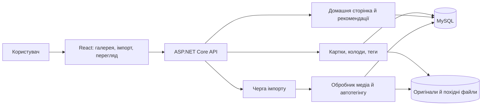
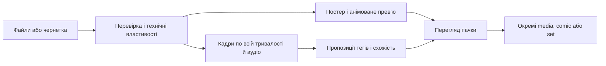
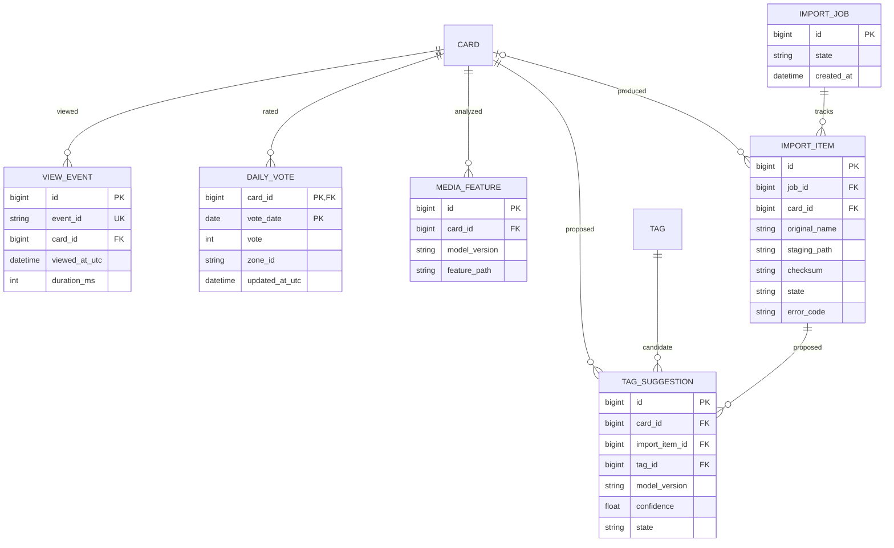

# План розвитку nodeck

Статус: проєктний план, 2026-11-04. Джерело вимог — обговорення з власником проєкту. Позначки `[ ]` означають заплановану роботу, а не відсутність у коді будь-якої реалізації. Після завершення задачі став `[x]` і додавай посилання на зміну або перевірку в короткому журналі наприкінці документа.

## Чек-лист

- [ ] **E1. Модель даних і безпечна міграція**
	- [x] **S1.1. Розмежувати картки, дочірні медіа та колоди**
		- [x] Зафіксувати інваріанти власності, видалення, порядку сторінок і членства в колодах.
		- [x] Запровадити зв'язок «один дочірній медіаоб'єкт — не більш як один comic/set».
		- [x] Додати операції збирання, розбирання й перевпорядкування comic/set із наявних карток.
		- [x] Реалізувати «видалити лише батька» та «видалити батька з усіма дітьми» з попереднім підрахунком наслідків.
	- [x] **S1.2. Спростити теги й джерела**
		- [x] Винести теги та джерела з типів карток у власні сутності; зберегти старі зв'язки під час міграції.
		- [x] Додати категорію, походження, псевдоніми та унікальне канонічне ім'я тега.
		- [x] Розділити технічні властивості файлу й смислові теги.
	- [x] **S1.3. Безпека переходу**
		- [x] Зробити версійні міграції БД, резервну копію й перевірку кількості карток, зв'язків та файлів.
		- [x] Передбачити відкат до початку запису в нову схему; після переходу перевірити посилальну цілісність.
- [ ] **E2. Медіапайплайн і автотегінг до масового імпорту**
	- [x] **S2.1. Приймання базових форматів**
		- [x] Підтримати JPEG/JPG, PNG, WebP, GIF, MP4, MOV і WebM; перевіряти вміст і кодеки, а не лише розширення.
		- [x] Зберігати оригінал і створювати окрему браузерну версію, коли оригінал не відтворюється на цільових пристроях.
		- [x] Витягувати розміри, тривалість, анімацію, відео- й аудіопотоки; помилки показувати пофайлово.
	- [x] **S2.2. Корисні прев'ю**
		- [x] Для статичних файлів створювати мініатюри; для GIF/відео вибирати змістовний фрагмент близько 3 секунд.
		- [x] Шукати кандидатів по всій тривалості; відкидати чорні/білі, надто темні, розмиті та майже порожні сцени.
		- [x] Зберігати постер і коротку анімацію, дозволити вручну замінити початок фрагмента.
		- [x] Обмежити витрати CPU/пам'яті та мати зрозумілий fallback, якщо вдалого фрагмента немає.
	- [x] **S2.3. Єдиний словник тегів**
		- [x] Імпортувати/індексувати потрібні теги Danbooru з категоріями general, artist, character, copyright, meta та псевдонімами; не вимагати ручного наповнення словника.
		- [x] Дозволити користувацькі теги з перевіркою дублікатів і повторним використанням.
		- [x] Зберігати походження кожного призначення: автоматично запропонований, підтверджений або доданий вручну; не переписувати ручні рішення автоматичним повторним аналізом.
	- [ ] **S2.4. Аналіз зображень, GIF і відео**
		- [x] Додати локальний WD ViT v3 для зображень, GIF і відео з чергою після завантаження, повторними спробами та пропозиціями тегів Danbooru.
		- [ ] Вибрати конкретні локальні моделі/інструменти для Danbooru-тегів, візуальної схожості й англійського мовлення після проби на реальних файлах; зафіксувати вимоги до CPU/GPU та версії моделей.
		- [x] Для зображень і вибраних кадрів прогнозувати теги з каталогу Danbooru з оцінкою впевненості.
		- [x] Для відео робити базовий прохід приблизно по 10 рівномірних ділянках із кількома кадрами навколо кожної; додатково перевіряти помітні зміни сцен у межах бюджету обробки.
		- [x] Аналізувати англійську мову в аудіо окремо від зображення; не плутати наявність аудіопотоку з наявністю мовлення.
		- [x] Перетворювати перевірені збіги англійських фраз на пропозиції з наявного словника тегів; не створювати теги з довільних слів транскрипту.
		- [x] Узагальнювати теги за впевненістю та повторюваністю, зберігаючи сильні короткі збіги; не втрачати рідкісну значущу сцену через просте усереднення.
		- [x] Пропонувати користувацькі теги за схожістю з підтвердженими прикладами; нові невідомі назви не призначати навмання.
		- [x] Дати змогу переглянути, прийняти, відхилити й виправити пропозиції; накопичувати приклади для майбутніх підказок.
		- [ ] На розміченій користувачем вибірці визначити пороги пропозицій і окремо виміряти помилкові теги для аніме та реалізму.
- [x] **E3. Масовий імпорт та організація вмісту**
	- [x] **S3.1. Чернетка змішаної пачки**
		- [x] Приймати файли перетягуванням і вибором; показувати тип, прев'ю, стан аналізу, помилки й дублікати.
		- [x] Дозволити пакетне створення окремих карток, comic і set, зміну порядку, назви, джерела й тегів до збереження.
		- [x] Зберігати чернетку та відновлювати її після переривання; не повторювати успішні файли через одну помилку.
	- [x] **S3.2. Фонове виконання**
		- [x] Додати чергу завдань із прогресом по файлу й пачці, обмеженням паралелізму, повторною спробою та скасуванням.
		- [x] Робити кроки імпорту повторювано-безпечними; прибирати тимчасові файли після збоїв.
		- [x] Перевірити пачки приблизно зі 100 змішаних файлів, включно з пошкодженими й повторними.
	- [x] **S3.3. Організація після імпорту**
		- [x] Створювати comic/set з уже наявних карток без копіювання файлів; заборонити двох батьків одному дочірньому медіа.
		- [x] Переміщувати, від'єднувати й упорядковувати дітей; оновлювати прев'ю та кількість елементів батька.
- [x] **E4. Галерея, колоди та перегляд**
	- [x] **S4.1. Єдиний візуальний переглядач**
		- [x] Зробити спільний компонент і API вибірки для глобальної галереї та колод; різниться лише область вибірки.
		- [x] Додати сторінкове завантаження, зрозумілий пошук, фільтри за назвами тегів/джерелами й стани порожньої/помилкової видачі.
		- [x] Зробити мобільну навігацію, клавіатурну навігацію та повноцінний перегляд зображень, відео, comic і set.
	- [x] **S4.2. Швидкі дії**
		- [x] Додавати/вилучати картку з колоди без великої форми; одна картка може бути в багатьох колодах.
		- [x] Редагувати картку й теги; відокремити «обране» від щоденного голосування.
		- [x] Показувати попередній перегляд наслідків перед усіма варіантами видалення.
	- [x] **S4.3. Мінімалістична сторінка картки**
		- [x] Дати основному медіа найбільше місця; залишити поряд короткі властивості та потрібні дії.
		- [x] Унизу показати горизонтальну стрічку рекомендацій зі свайпом і кнопками переміщення.
- [x] **E5. Події, рекомендації та домашня сторінка**
	- [x] **S5.1. Сигнали інтересу**
		- [x] Записувати фактичний перегляд з часом, а не кожне завантаження сторінки; зберігати обмежену недавню історію.
		- [x] Додати голос +1/−1/0 для однієї картки на день; наступного дня дозволити новий голос.
		- [x] Визначити денний зріз у часовій зоні користувача; «обране» залишити окремою дією.
	- [x] **S5.2. Ранжування та згортання дітей**
		- [x] Поєднати схожість вмісту й тегів із недавніми переглядами, голосами, новизною та різноманітністю.
		- [x] За замовчуванням замінювати збіг дочірньої сторінки її comic/set; не множити результат за кількістю сторінок.
		- [x] Додати режим «показати окремі сторінки» для пошуку конкретного зображення.
		- [x] Виключати видалені, недоступні й явно відхилені елементи; мати fallback без історії та без тегів.
	- [x] **S5.3. Домашня сторінка**
		- [x] Створити ленти «Нещодавно додано», «Для вас» і «Добірка дня» з переходом до повної видачі.
		- [x] Формувати добірку дня детерміновано на день як віртуальну видачу, не додаючи її до списку колод.
		- [x] Зробити стрічки керованими свайпом, мишею та клавіатурою; не дублювати технічні заголовки й підказки.
- [ ] **E6. Якість і готовність до використання**
	- [ ] **S6.1. Автоматичні й ручні перевірки**
		- [x] Покрити міграції, власність дітей, обидва видалення, членство в колодах і відновлення після помилок.
		- [x] Перевірити формати на реальних зразках, включно з MOV із різними кодеками, GIF і відео з/без звуку.
		- [ ] Оцінити якість тегів, коротких сцен і прев'ю на вибірці аніме, ілюстрацій та реалізму; зафіксувати пороги й помилки.
		- [x] Перевірити рекомендації на холодному старті, повторних денних голосах і багатосторінкових comic.
	- [x] **S6.2. Продуктивність та UX**
		- [x] Виміряти час імпорту, пам'ять, навантаження CPU, швидкість галереї та рекомендацій на реальному обсязі бібліотеки.
		- [x] Перевірити настільний і мобільний сценарії, контраст кольорів тегів, фокус, підписи кнопок і доступність без кольору.
		- [x] Оновити README та інструкції резервування/відновлення за фактично реалізованою поведінкою.

## Межі та незмінні рішення

- `media` — одна самостійна одиниця вмісту: зображення, GIF або відео. GIF є типом медіафайлу, а не окремою ієрархією карток. `comic` і `set` — повноцінні картки з дочірніми `media`; `comic` має порядок сторінок, `set` також може мати порядок показу. Дочірня картка має 0 або 1 батька; батько має 0 або багато дітей. Дозволити порожнього батька під час редагування, але не публікувати його як готовий comic/set.
- Колода — незалежний список посилань. Будь-яка картка, включно з comic/set та їхніми медіа, може входити до багатьох колод. Видалення колоди видаляє тільки її членство; видалення картки прибирає її з усіх колод.
- «Видалити батька» від'єднує дітей. «Видалити батька й вміст» видаляє батька й усіх дітей разом із файлами та посиланнями на них у колодах. Перед виконанням показати точні лічильники. Видалення окремої дитини оновлює порядок, кількість і постер батька.
- Теги й джерела — окремі довідникові дані, не картки. Категорії Danbooru: general, artist, character, copyright, meta; користувацький тег має окреме походження/вигляд. Технічні властивості (`image`, `video`, `gif`, `has_audio`, кодек, розміри) лишаються властивостями файлу й джерелом істини; системні мета-теги (категорія meta, походження system) виводяться з них автоматично й не редагуються вручну; користувацький тег може мати будь-яку категорію. Інтерфейс показує мета-теги оранжевими чипами поруч із тегами.
- Кольори: метадані — помаранчевий, artist — червоний, character — зелений, copyright/тайтл — фіолетовий, general — сірий, користувацький — бірюзовий. Автоматична пропозиція відрізняється значком/контуром до підтвердження; колір не є єдиним сигналом.
- Версія 1 розрахована на одну локальну бібліотеку; якщо згодом з'являться облікові записи, події перегляду й голоси потрібно прив'язати до користувача. Це припущення плану, а не реалізована можливість.

## Стан коду на момент планування

Є `media`, `comic`, `set`, `tag`, `source`; для comic/set нові дочірні зображення створюються під час завантаження. Є колоди, `deck_cards`, обране, галерея і автоматична генерація прев'ю. Нинішня операція видалення comic/set видаляє і дочірні картки. Галерея фільтрується за ID тегів і джерел та бере до 200 карток. Домашньої сторінки, подій перегляду, денних голосів, рекомендацій, автотегінгу й масового імпорту немає. Це опис наявного коду, не відсоток готовності продукту.

Оновлення 2026-11-06: зображення, GIF і відео автоматично отримують пропозиції тегів через локальну модель після завершення імпорту тегів Danbooru; завдання зберігаються в MySQL. Для GIF і відео вибираються до 30 базових кадрів та до 10 додаткових кадрів між помітно різними ділянками в межах 15 секунд на додаткові проби. Міграція 7 й окремий worker аналізують аудіо нових або замінених відео через локальні Whisper/VAD: мова, мовлення, англійське мовлення й охоплена тривалість зберігаються без транскрипту. Порожній або неоднозначний результат лишається невизначеним. Для підтвердженого англійського мовлення точні фрази з 2–4 слів зіставляються з назвами та псевдонімами наявних тегів Danbooru `general` або користувацьких тегів, які раніше призначали вручну чи підтверджували. Міграція 8 додає джерело пропозиції з типовим значенням `visual` для попередніх записів. Візуальна схожість і калібрування на реальних файлах лишаються відкритими.

Опорні файли: `database/init/001_cards.sql`, `backend/src/Cards/`, `backend/src/Decks/`, `backend/src/Storage/PreviewService.cs`, `frontend/src/pages/`, `frontend/src/components/visual-card-wall.tsx`. Міграції мають замінити залежність від створення таблиць лише стартовим SQL та ініціалізаторами, не переписуючи існуючі дані. Зовнішні довідники для реалізації: [категорії й API тегів Danbooru](https://safebooru.donmai.us/wiki_pages/api%3Atags), [сумісність медіаконтейнерів і кодеків у браузерах](https://developer.mozilla.org/en-US/docs/Web/Media/Guides/Formats/Containers), [аналіз потоків ffprobe](https://ffmpeg.org/ffprobe.html).

## Цільова архітектура

Одна вебпрограма React звертається до ASP.NET Core API. API обслуговує синхронні операції з картками, колодами й видачею та ставить важкі медіазадачі у фонову чергу. Обробник аналізує файли, створює прев'ю, обчислює візуальні ознаки, пропонує теги й повертає результат у чернетку імпорту. MySQL зберігає структуру, стан задач та сигнали інтересу; файлове сховище — оригінали й похідні файли. На старті обробник може бути окремим процесом у тому самому розгортанні; зовнішні сервіси не є обов'язковими.

Порядок обробки: приймання файлу → перевірка формату/потоків → технічні властивості → нормалізація відтворення та прев'ю → вибір кадрів/аудіо → модельні пропозиції Danbooru й користувацьких тегів → перегляд людиною → збереження підтверджених зв'язків. Автоматичні пропозиції зберігаються окремо від затверджених призначень. Повторний запуск із новою моделлю не змінює ручні рішення.

## Модель даних

Нижче — **цільова логічна схема**, не поточний SQL. Показані ключі й важливі поля; індекси, часові поля та службові стани додаються в міграціях. Унікальність `CARD_CHILD.child_card_id` задає не більш як одного батька. Видалення дітей — явна транзакційна операція сервісу, а не неявний каскад від `CARD` до `CARD_CHILD`.

Для історії та фонової обробки окремі таблиці. Реалізована `card_view_events` зберігає до 500 недавніх фактичних переглядів із тривалістю та унікальним UUID події; `card_daily_votes` має ключ `(card_id, vote_date)` і допускає зміну вибору протягом дня та новий вибір наступного дня. Браузер передає часову зону IANA, а сервер обчислює локальну дату. Поточні сигнали належать одній локальній бібліотеці без окремих профілів і `viewer_key`. `TAG_SUGGESTION` не є прийнятим тегом: до збереження він належить елементу чернетки імпорту, після збереження або повторного аналізу — картці; рівно один із цих зв'язків має бути заданим. Візуальні ознаки версіонуються, щоб перерахувати їх після зміни моделі. Денна добірка обчислюється за датою і не є `DECK`.

Правила БД: FK на `DECK_CARD` і призначення тегів видаляються при видаленні картки; `CARD_CHILD` має унікальні `(parent_card_id, position)` і `child_card_id`. Цикли виключаються типами: батько лише `comic`/`set`, дитина лише `media`; ці перевірки забезпечує транзакційний сервіс і тести. Після від'єднання дитина лишається в `CARD`, з незмінним `MEDIA_ASSET`. Унікальні зовнішні ідентифікатори Danbooru діють лише для імпортованих тегів; користувацькі теги не потребують зовнішнього ID.

## Правила видачі й оцінювання

- Галерея й колода використовують однаковий переглядач та фільтри, але різні запити: усі верхньорівневі картки проти членів конкретної колоди. Дочірні `media` доступні напряму й у режимі окремих сторінок, але не засмічують основну видачу.
- Наявне ранжування використовує призначені теги, перегляди за останні 30 днів і денні голоси за останні 90 днів. Бонус свіжості за `created_at` становить не більш як 2 бали. Перший пов'язаний результат після вже обраної картки не штрафується; починаючи з третьої картки зі спільним призначеним тегом, штраф становить 4 бали за кожне подальше повторення найчастішого тега кандидата. У відповіді повертається бал на момент вибору. За рівності балів перевагу має більший ID. Одне значення поточного часу UTC на запит визначає часові вікна, згасання сигналів і свіжість. Візуальні embeddings ще не додано.
- Обидва API рекомендацій перевіряють читабельність збережених файлів перед видачею. Для `media` потрібен оригінал і, якщо в metadata задано рядковий шлях відтворення, його копія; JSON `null` не вимагає копії. Для comic/set потрібні читабельне прев'ю обкладинки й хоча б одна читабельна дочірня `media`. Відсутні, нечитабельні та лексично позасховищні шляхи не проходять перевірку. Денна видача переглядає детермінований порядок сторінками по 100, максимум 5 000 кандидатів на режим; картки поточного дня є fallback лише за відсутності читабельних старіших. Перевірка дітей обмежена 10 000 рядків на групу зі 100 колекцій. Через ці межі відповідь може бути коротшою за `limit`, навіть коли придатні картки є далі. Якщо URL прев'ю не завантажився у браузері, плитка показує тип картки.
- Якщо релевантна дитина має comic/set, стандартний результат — батько. Бал батька походить від найкращих кількох дітей, а не суми всіх сторінок; інакше довгі комікси отримають несправедливу перевагу. Перемикач «окремі сторінки» повертає саме дітей.
- На сторінці картки ранжування використовує поточну картку та недавню історію. Після видалення/відхилення результат не з'являється з кешу. Без історії показуються свіжі й різноманітні картки, а не порожній блок.
- «Добірка дня» має стабільний результат протягом локального дня й оновлюється при зміні дати; її не можна плутати зі збереженою колодою.

## Контрольні точки та критерії прийняття

| Після епіка | Критерій завершення | Залежить від |
| --- | --- | --- |
| E1 | Старі дані перенесені без втрат; власність 0..1 дотримана; обидва видалення й від'єднання перевірені; колоди зберігають правильні посилання. | Поточна схема |
| E2 | Кожен базовий формат дає коректний результат або явну помилку; GIF/відео мають постер і вибраний анімований фрагмент; теги можна прийняти/відхилити; англійське мовлення аналізується окремо. | E1 |
| E3 | Змішана пачка приблизно зі 100 файлів відновлюється після збою; окремі, comic і set формуються без повторного завантаження; помилки ізольовані по файлах. | E2 |
| E4 | Галерея й колода мають спільний досвід перегляду; пошук і фільтри не вимагають ID; мобільний екран придатний для роботи. | E1–E3 |
| E5 | Є три домашні ленти, нижня лента на сторінці картки, денні голоси й згортання сторінок до батька; результати мають fallback. | E2, E4 |
| E6 | Автоматичні перевірки й ручні сценарії пройдені; відомі межі якості тегів і прев'ю задокументовані; інструкції відповідають реалізації. | E1–E5 |

Кожен епік завершується оглядом змін, тематичними тестами backend, збіркою frontend за потреби та коротким записом фактичних результатів. Наступний епік не повинен приховано змінювати прийняті інваріанти попереднього: якщо це необхідно, спочатку онови цей документ і критерії прийняття.

## Журнал виконання

Формат запису: `YYYY-MM-DD — E/S — зміна або посилання — перевірки — відомі обмеження`.

- 2026-11-11 — E2/S2.4, вивчені користувацькі теги (міграція 13 `learned-custom-tags-v1`): візуальний аналіз зберігає для кожної ревізії картки розріджений вектор імовірностей усіх міток WD (≥ 0,02, до 384 значень; для GIF/відео — максимум по кадрах) у `card_visual_features`. Для кожного custom-тегу з ≥ 5 прикладами `manual`/`confirmed` фоновий воркер навчає логістичну регресію (AdaGrad, L2); відхилені й виправлені пропозиції з `card_tag_suggestions` і `card_tag_decisions` — жорсткі негативи з вагою 3, решта карток — звичайні негативи (до 3000), сторінки збірок із цим тегом не використовуються. Поріг обирається 3-кратною крос-валідацією: найнижчий зріз з оцінкою точності ≥ 0,8 на всю бібліотеку, ≥ 3 правильних прикладів, не нижче 0,5; інакше тег нічого не пропонує. Пропозиції (до 10 на картку) йдуть у `card_tag_suggestions` з `suggestion_source = 'learned'` і ключем `learned-lr-v1:g<покоління>`, тому перегляд, Accept all і журнал рішень працюють без змін. Перенавчання — коли змінюються приклади, рішення чи ознаки, не частіше ніж раз на 10 хв; застарілі пропозиції відкликаються. Старі картки доаналізовуються пачками по 25 з пріоритетом 1 (після всіх звичайних завдань). `GET /api/learned-tags` — стан моделей. Перевірки: `dotnet test backend/tests/MyApp.Api.Tests.csproj` — 308/309 (1 пропущено: тест реальної моделі WD без встановленої моделі) на ізольованій тимчасовій MySQL 8.4 у контейнері SDK 9 з FFmpeg; нові тести `LearnedTagSuggestionTests` (навчання й пропозиції з фейковим джерелом ознак, рішення та жорсткі негативи, відкликання, заміна медіа, збереження ознак, доаналіз і пріоритет черги) і `LearnedTagClassifierTests`; тест міграції перевіряє 13-ту на базі з версії 11. Обмеження: признаки — імовірності міток, а не ембединг передостаннього шару (ONNX-модель має лише вихід оцінок); пороги й точність на реальній бібліотеці не виміряні; немає перемикача чи порога для окремого тегу; повний доаналіз відео на CPU може тривати дні.

- 2026-11-11 — Реліз 0.1.1, встановлення на ZimaOS через імпорт compose (як у Gallery): `docker-compose.zima.yml` (два сервіси, дані в `/DATA/AppData/nodeck`, `x-casaos` для плитки на панелі, іконка `deploy/zimaos/icon.svg`); образ `ghcr.io/cabinet-being/nodeck` публікує `.github/workflows/docker.yml` (`:main` з `main`, `:X.Y.Z` і `:latest` з тегу `v*`, тег звіряється з `VERSION`). Backend сам створює базову схему в порожній базі (SQL з `database/init` вшито в збірку; частково заповнена база й надалі відхиляється), сам качає моделі WD/Whisper з перевіркою SHA-256 (`NODECK_MODEL_AUTO_DOWNLOAD`), збирає рядок підключення з `MYSQL_*`, чекає на MySQL до 2 хв замість падіння; healthcheck MySQL іде через TCP, бо тимчасовий сервер першої ініціалізації без мережі вважався готовим (backend тричі перезапускався). Виправлено 413 для завантажень понад ~30 МБ (`NODECK_MAX_UPLOAD_MB`, типово 8192). Перевірки: нові тести (ліміт завантаження, створення схеми, завантаження моделей); імітація імпорту в чистій теці лише з YAML і локально зібраним образом: `change-me` відхилено до ініціалізації, готовність 20–23 с без перезапусків, моделі ~520 МБ скачано й перевірено, словник WD 10857 тегів, нове зображення отримало теги WD, відео 33 МБ прийнято. Обмеження: на справжній ZimaOS не перевірено; образ на GHCR з'явиться після push, пакет треба зробити публічним; оновлення зі зміною схеми досі потребує резервної копії скриптами.

- 2026-11-11 — Підготовка релізу 0.1.0 для ZimaOS (`6ee6a14`, `5520fe1`, `dbb473e`): рішення: один образ (UI + API, `Dockerfile` у корені, UI віддає backend); поставка пакетом `docker save` — на цільовому пристрої немає git і збірки; допоміжні скрипти лише на Docker (`install-models.sh`, `library-backup-docker.sh`, `export-db.sh`), бо ZimaOS не має пакетних менеджерів і openssl; дані — звичайні теки в AppData; доступ до MySQL з LAN — за бажанням (`MYSQL_BIND_ADDRESS`), порт MySQL у релізі 33306; захист від `change-me` (compose, backend і entrypoint MySQL, бо MySQL зберігає пароль під час першої ініціалізації); моделі виключено з резервних копій і зберігаються під час відновлення; автозасів словника WD. Перевірка свіжого встановлення з пакета на ізольованому стеку: `docker load`, готовність за 12–23 с, `/health` з версією 0.1.0, глибокі посилання SPA — 200, `/api/nope` — 404, заголовки кешу; `change-me` відхиляє MySQL до ініціалізації (`mysql_data` лишається порожньою) і backend; `install-models all` за ~1 хв; автозасів 10 857 тегів; завантаження → 9–10 тегів, зокрема мета-теги; транскодування HEVC; `export-db` — SQL з 18 таблицями; резервна копія в контейнері 120 КБ без моделей (було 507 МБ); відновлення зберігає моделі; повторне розпакування архіву поверх встановлення зберігає `.env` і дані; повний набір backend 292/292. Документація: README (розділи про встановлення на ZimaOS, розташування даних, збірку релізу), `CHANGELOG.md`. Обмеження: не перевірено на реальному пристрої ZimaOS; назви меню ZimaOS узято з документації; лише amd64; встановлення з CLI не показується в панелі ZimaOS.

- 2026-11-11 — Відгук: каруселі, читалка, «Назад» (`93da5af` … `7965667`): каруселі гортаються до меж плиток з урахуванням цілі, що вже в русі; обов'язковий snap лише на дотик; смуги країв повної висоти змонтовані постійно, голі шеврони вирівняно з краями скролера (причини: snap конфліктував із плавним `scrollBy`, перемонтування під час скролу, кнопки 40 px над плитками); зони тапу в читалці comic/set покривають усю сцену (причина: зони накривали лише зображення); шеврони-підказки без кіл; «Назад» відновлює стан через параметри URL з `replaceState` (`tab`, `q`, `type`, `order`, `p`, `mode`, `item`, `layout`, `similar`) та скрол, лічильник Similar і зсуви каруселей для кожного запису історії. Перевірки справжніми кліками у видимому браузері: 7 кліків по каруселі спрацювали всі, тап по темних полях гортає сторінки, «Назад» відновив вкладку Tags зі скролом 500, comic `p=3`, сторінку 2 галереї зі скролом 1000, зсув каруселі 1504, пошук колод. Автоматичних frontend-тестів немає.

- 2026-11-10 — Відгук користувача після редизайну (`1739164`, `f1bdf96`): дев'ять запитів і що зроблено. (1) Вибір Grid/Masonry не зберігався між Gallery і Home — тепер одне налаштування для всіх стін (`nodeck.cardView`). (2) Сторінки Library змінювали ширину залежно від наявності елементів — ширина стабільна (`scrollbar-gutter: stable`). (3) Кнопки прокрутки каруселей на Home перенесено з заголовка на боки, по центру плиток. (4) Similar на сторінці картки — не карусель, а сітка, що продовжується нижче (як pixiv): до 50 карток, показ по 24 при прокрутці, без See all і стрілок. (5) Comic і set: бічні кнопки; на одиночній сторінці ліва третина — попередня сторінка, права — наступна, середина відкриває картку сторінки. (6) Порожні горизонтальні лінії під час переходів — плитки одразу резервують розмір (сітка — фіксований аспект, masonry — width/height із metadata) із заглушкою до завантаження прев'ю та плавною появою. (7) Нові custom-теги не з'являлися у вкладці Custom — `sort=usage` без пошуку тепер включає й невикористані користувацькі теги, а Custom означає категорію custom. (8) Ручне створення тегів у будь-якій категорії (діалог із вибором категорії, за замовчуванням — поточна вкладка) і зміна категорії імпортованих тегів (ім'я та аліаси імпортованих незмінні): `POST/PUT /api/tags` приймають `category` (хибна → 400; 409 для зміни імені імпортованого та для системних тегів); видалення — невикористані користувацькі теги будь-якої категорії; фільтр category збігається з `tags.category` незалежно від походження. (9) Мета-теги з властивостей файлу: системні теги (категорія meta, походження system) `image`, `gif`, `video`, `animated`, `sound`/`silent`, `horizontal`/`vertical`/`square_image` (|w/h−1| ≤ 0.05), `highres` (≥ 1600), `absurdres` (≥ 3200), `lowres` (< 500), `comic_book`, `set`; синхронізуються після завантаження/заміни та backfill при старті; зайняте ім'я пропускається з попередженням; PUT/DELETE на картці → 409; працюють у пошуку, фільтрі `catalog_tags` і рекомендаціях (множник 0.3); на сторінці картки — оранжеві чипи в групі File. Також: дії ✓/✗/✎ підказок тегів накладаються поверх чипа й не займають місця. Рішення: мета-теги матеріалізовані, а не віртуальні; імена `square_image` і `comic_book`, бо `square` і `comic` — загальні теги WD; тап ліворуч = назад; Similar завантажує до 50 (ліміт API), показує по 24. Перевірки: повний backend-набір 290/290 (до перейменування) і `TagCategoryAndMetaTagTests` 16/16 після перейменування; тести Catalog оновлено під нову семантику категорій; `tsc` і збірка vite пройшли; браузер на копії реальної бібліотеки: стабільна ширина 896 px (порожній і заповнений стан), Similar 24→50 при прокрутці, стрілки rail по центру плиток, тап-зони comic 379→380→381→380, середина відкрила картку сторінки, бічні кнопки set, група File з мета-чипами, новий тег Artist створено з вкладки Artist, вкладка Custom показує невикористані користувацькі теги, backfill 380 карток, 0 пропущено (image 360, vertical 243, horizontal 96, square_image 38, …). Обмеження: плитки masonry у стрічці/Similar до завантаження мають 1:1 (рекомендації не повертають width/height); інлайн-створення тега в інспекторі картки створює лише custom; читання манґи справа наліво не пропонується; анімації не перевірено (панель прихована).

- 2026-11-10 — Редизайн інтерфейсу (cea2a4d … 96d66ca), E6/S6.2 п. 2: запит користувача — сучасний, інтуїтивний інтерфейс у темі «вузли й картки» замість «кокпіта». Етапи S1–S6: `cea2a4d`, `dd5cca4` — основа (оболонка з верхньою панеллю, мобільна нижня панель вкладок із листом More, тема system/light/dark у `nodeck.theme`, палітра Ctrl/⌘K, галерея з одним полем пошуку, поповером Filter, з'єднаними чипами фільтрів і перемикачами Collections/Pages та Grid/Masonry); `f62275a` — сторінка картки: медіасцена (fit/actual, повноекранний режим, завантаження) та інспектор (вподобання, голос, поповер Deck, меню ⋯, теги з непереглянутими авто-тегами в рядку, режим Select, Accept/Reject all, пропозиції, джерела, колоди, пов'язані картки, рядок файлу, лист Details із графом зв'язків і JSON); `0e7bf2f` — колоди як віялові стоси з лениво завантаженими обкладинками, плиткові сітки колоди й обраного з портами видалення; `2afbafe` — API: `GET /api/tags` отримав необов'язкові `sort=name|usage` і `category=general|artist|character|copyright|meta|custom` (хибні значення → 400; фільтр діє до ліміту 200; відповідь не змінилась), на реальній бібліотеці перші 200 за алфавітом були невикористаними записами словника WD; `1978d8d` — спокійніший імпорт (одна головна кнопка зі станом, зона скидання, apply-to-all, прогрес і підсумок, рядки черги зі статусом і поповером), каталог тегів і джерел з вкладками категорій, форми; `96d66ca` — доступність і доведення (фокус, підписи, мінімальні цілі дотику, контраст, глифи категорій). Рішення: англомовний інтерфейс збережено; синій акцент; пагінація сторінками; обкладинки колод вантажаться лениво, не більш як 4 запити одночасно; мертві посилання Settings/Service прибрано; `/cards` перенесено в Library → Manage cards; технічний JSON і граф зв'язків винесено в лист Details. Перевірки: `tsc -b` і `vite build` проходили на кожному етапі; тести backend Catalog 28/28 пройдено (нові тести sort/category у `CatalogApiTests`); перевірки в браузері на копії реальної бібліотеки при 1440 px і 375 px, світла й темна теми: перехід із палітри до тега, збереження стану в URL (пошук, `view=pages`, сторінка) туди й назад, повернуте відео в портретній орієнтації, підтвердження й відхилення тега, видалення з колоди, обране, вкладки використання й категорій тегів, 404, мобільні зони дотику 40 px, відсутність горизонтального прокручування; виправлено попередження React про ref/key (Button через forwardRef); аудит контрасту: світлий акцент 4,31 → 5,11, усі пари кольорів тегів ≥ 5,5:1, нові success/warning ≥ 6,4:1. S6.2 п. 2 закрито цим редизайном; S6.1 п. 3 лишається відкритим (потрібна розмічена користувачем вибірка якості), тому заголовок E6 не позначено. Обмеження: анімації й кінцеві стани переходів не перевірено (панель браузера була прихована, `requestAnimationFrame` призупинявся); автоматизованих тестів frontend немає; iOS Safari не перевірено; списки тегів і джерел обмежені 200 записів без сторінок; кеш обкладинок колод не скидається до перезавантаження.

- 2026-11-10 — E6/S6.1–S6.2 (`e007bab`, `e7cbf73`, `90bb823`, `6ecb719`): перевірка на копії реальної бібліотеки (знімок тестового розгортання користувача лише для читання; оригінали не змінювались): 347 медіакарток (334 зображення, 12 mp4 h264/aac, 1 gif), 711 файлів, 827 МБ, 10 857 тегів, 8 067 зв'язків тегів, 8 074 пропозиції, 45 переглядів, 7 денних голосів, схема v10. Шлях оновлення за README: `library-backup.sh backup` 5,4 с → застосовано міграції 11–12, API готове за 2,8 с; backfill хешів обробив 347 оригіналів, дублікатів 0; відновлення 6,7 с повернуло v10 і 347 карток, повторна міграція пройшла. Захист міграції відмовився стартувати без перевіреної резервної копії (за задумом). Затримки API (медіана, 15 запусків, реальна копія): галерея 3–4 мс; деталі картки 2 мс; список тегів 3 мс; колода 1,5 мс; daily 5 мс; рекомендації for-you 60–75 мс, контекст ~40–60 мс; текстовий пошук 839 → 10 мс (без збігів 1,4 с → 20 мс); фільтр за тегом каталогу 66 → 8 мс (один тег), 158 → 15 мс (три теги), `e007bab`. Ендпоінт тегів картки ~21 мс (сканує каталог тегів; залишено). Імпорт: 40 реальних зображень (перекодовані, щоб обійти дедуплікацію) завантажено за 6,5 с (медіана 65 мс, максимум 0,76 с на файл); автотегування WD ViT для всіх 40 завершилось через 47 с від старту (~1 с/зображення); пік backend ~2 ядра CPU і 945 МіБ RAM (контейнер обмежено 2 ГіБ). Формати (згенеровані реалістичні зразки через реальний імпорт): MOV h264+aac, MOV HEVC+aac, MOV HEVC без звуку → транскодування в playback.mp4; mp4 без звуку без транскодування; завдання мовлення лише для файлів зі звуком; GIF працює; усе отримало теги. Знайдено й виправлено дефект: поворотне телефонне відео (матриця 90°) зберігало в метаданих закодовані 1280×720, тоді як відтворення й постер були 720×1280 (`6ecb719`); у реальній бібліотеці таких відео немає, backfill не потрібен. Якість тегів (дані): 7 867 авто- і 200 підтверджених зв'язків; користувач переглянув пропозиції лише на 10 картках: 200 прийнято / 7 відхилено (відхилені: pov 0,35, food 0,68, sash 0,52, obi 0,50, jewelry/weapon/pubic hair без впевненості); пропозиції в очікуванні за впевненістю: 0,35–0,5 — 1 645, 0,5–0,7 — 2 027, 0,7–0,9 — 2 235, ≥0,9 — 1 960; відео впираються в ліміт 40 тегів (середнє 39). Категорії лише general і character (без artist/copyright). Вибірка замала й лише аніме, щоб калібрувати пороги чи оцінювати реалізм, тому п. 3 S6.1 лишається відкритим і потребує розміченої користувачем вибірки. Рекомендації на реальній історії: affinity упирався в ліміт ±12 для 296 із 347 карток, а «Для вас» очолювали вже вподобані картки; виправлено нормалізованим affinity, leave-one-out і пріором для рідко тегованих карток та прибранням виключення `+1` зі штрафу за перегляд (рішення: ротація важливіша за луну; вподобані повертаються після `SeenWindowDays`), `90bb823`. Після виправлення топ-20 містить небачені схожі картки; картка з одним тегом більше не посідає перше місце. Інше: backfill хешів попереджає про відсутні оригінали, MySQL прив'язано до loopback (було 0.0.0.0:3306), `e7cbf73`. Перевірки: повний набір backend 268/268 пройдено, 0 пропущено (тест WD ViT виконано з реальною моделлю); нові тести: `CardSearchApiTests` (5), `CardCatalogTagFilterApiTests` (5, проходять і на SQL до переписування), 3 тести рекомендацій + 1 переписаний (повторні голоси, відносний профіль) + 1 перейменований (вподобана, але переглянута картка штрафується), тест `PreviewService` для повернутого відео (падає на старому коді). Обмеження: відкриті п. 3 S6.1 (розмічена вибірка якості) і п. 2 S6.2 (контраст, фокус, підписи, доступність без кольору; переходить у повний редизайн UI, запитаний користувачем 2026-11-10); S2.4 досі заблоковано; iOS не перевірено.

- 2026-11-10 — E5/S5.2–S5.3 (`dc315b0`, `41f18de`): ранжування переписано. Опції секції `Recommendations` в `appsettings.json` (`WAffinity` 1, `WContext` 1, `WSuggest` 0,5, `WSelfVote` 1, `WSeen` 1,5, `WFresh` 1, `WDiversity` 4, `SuggestMinConfidence` 0,5, `SeenWindowDays` 3, `CategoryMultipliers` artist 1,5/character 1,3/copyright 1,2/custom 1,2/general 1,0/meta 0,3, `UnknownCategoryMultiplier` 1,0; решта констант має типові значення в `RecommendationOptions.cs`). Специфічність тегу `spec(t)=catMul·ln(1+N/(1+df))/ln(1+N)`. Бал = `WAffinity`·clamp(Σ профіль·spec, ±12) + `WContext`·8·частка спільної специфічності контекстних тегів + `WSuggest`·min(3, Σ очікувані непризначені пропозиції з confidence ≥0,5 · max(профіль, 4 для контекстного тегу) · spec) + `WSelfVote`·власні голоси (+2/−3, ±8) − `WSeen`·min(3, згасання переглядів за 3 дні; пропускається, якщо останній голос +1) + `WFresh`·2/(1+вік/7); MMR-різноманітність −4 за кожне повторення тегу після другого без змін. Перегляди більше не підвищують бал самої переглянутої картки, а наповнюють профіль тегів. Очікувані пропозиції також додають кандидатів (≤50 на найсильніший тег); відхилені ігноруються. Відповідь і ендпоїнти не змінилися. Frontend: у галереї перемикач Collections/Pages (`view=pages`, лише галерея) показує медіакартки, зокрема сторінки comic/set, без згортання; зміна режиму скидає на сторінку 1 і зберігає пошук і фільтри. Стрічка на головній і `/feed/recommended` названа «For you»; на сторінці картки лишається «Recommended». Рішення (рекомендовані типові): новизна = бонус свіжості + штраф за побачене; картки з +1 звільнені від штрафу; пропозиції тегів — сигнал зниженої ваги; режим сторінок у галереї — лише медіа; повні видачі лишаються з лімітами 50/30 без пагінації. Схожість вмісту = теги й пропозиції тегів; візуальна схожість відкладена до рішення S2.4. Перевірки: тести рекомендацій 34/34 (8 нових: рідкісний vs поширений тег, artist vs general, очікувана vs відхилена/низькодостовірна пропозиція, штраф за побачене, виняток +1, перевизначення `WSeen=0` і `WFresh=0`, без історії й контексту); тестовий scope створює `card_tag_suggestions` (без цього 6 тестів падали з 500); повний backend-набір: 254 пройшли, 1 пропущено (модель WD ViT не встановлена), 0 помилок; `tsc -b` і `vite build` пройшли. Браузер на ізольованому API: на головній «Recently added» / «For you» / «Today's picks»; пошук «anim_02» у Collections нічого не знаходить, у Pages — сторінку #2 набору. Живий API на тестовій бібліотеці (без тегів і історії): `/api/recommendations` повертає 20 карток за fallback свіжості (~0,13 с перший виклик, ~0,02 с наступні); з `contextCardId` контекстна картка виключена; `mode=pages` і `/daily` повертають 200. Межі: ваги не калібровано (немає реальної бібліотеки); візуальної/embedding-схожості немає; `card_tag_suggestions` не має індексу за `tag_id`, тож запит кандидатів за пропозиціями сканує таблицю; `N` рахує верхньорівневі картки без перевірки доступності файлів; штраф за побачене враховує лише 500 останніх переглядів; повні видачі обмежені 50/30. E5 закрито.

- 2026-11-10 — E4/S4.1–S4.3 (`ec18c51`, `03519dd`, `bf9da74`): `GET /api/cards` приймає `deck_id` (додатне ціле; 400 «deck_id must be a positive integer.», 404 для невідомої колоди). Усі фільтри (search, catalog_tags, catalog_source, старі tags/source, exclude_contained_media, limit/offset) діють усередині колоди. `sort=position` дозволено лише з `deck_id` (інакше 400), з `deck_id` це типове сортування: позиція в колоді, потім id. Підсумки карток дістали `deckPosition` (з 0) і `membershipProperties`, поза областю колоди вони `null`. `GET /api/decks/{id}?include_cards=false` повертає `cards: []`; деталі колоди тепер мають `cardCount`. Frontend: галерея й сторінка колоди спільно використовують `CardBrowser` (`components/card-browser.tsx`) і `CatalogFilterBar`: пошук у URL, теги/джерело за назвою, видимі чипи з видаленням і Clear all, сторінка 48 карток з Previous/Next (`?page=`), порожній стан («No matches…» + Clear filters) і помилка з Retry. Сторінка колоди показує «#n · тип · ID» і Remove from deck (оновлює список; якщо сторінка спорожніла, повертається на попередню). Сторінка обраного не змінилась (окремий список). Сторінка картки: медіа займає більшість місця (lg — дві колонки, бічна панель 20rem) з назвою, обраним, денним голосом, тегами/джерелами та керуванням Decks; зв'язки й технічний JSON — у згорнутому розділі «More». `MediaViewer`: зображення Fit/Actual size і повноекранний режим (прихований без Fullscreen API), відео — рідний плеєр. `SetViewer`: велика вибрана дитина, кнопки prev/next, стрілки, свайп, мініатюри, «n / total», Open card (SPA), перемикач Wall. Читач comic використовує спільний хук `usePagerInput`. Мобільне меню закривається Escape і дотиком поза ним. Керування Decks: пошук колод за назвою та вбудоване «New deck title» → Create and add. Тести: `CardListScopeApiTests` (6) і `DeckMembershipApiTests` (4, HTTP: PUT/DELETE ідемпотентні 200, відсутня колода 404, відсутня картка 400, колода обраного 400, картка у двох колодах). Повний backend-набір у контейнері .NET 9 з ffmpeg на ізольованій MySQL 8.4: 246 пройшло, 1 пропущено (модель WD ViT не встановлена), 0 помилок; підмножина колод 18/18 після виправлення `cardCount`. `tsc -b` і `vite build` пройшли. Перевірка в браузері (ізольований API + Vite на тестовій БД, desktop і 375px): сторінка колоди в порядку позицій із кількістю; пошук у галереї, стан без збігів, сторінка 2 (48+41=89 карток); пошук усередині колоди; сторінки зображення, відео та set; кнопка set viewer і ArrowRight 1/3→3/3, Open card без перезавантаження; мобільне меню Escape/поза меню; немає горизонтального прокручування на 375px; вбудоване створення колоди додає картку; Remove from deck оновлює список і ущільнює позиції; помилок у консолі немає. Обмеження: діти set показуються як зображення (`ContainedCard` не має типу медіа), тому відео-дитина показує прев'ю, а не відтворення; повноекранний режим і відео на iOS Safari на пристрої не перевірено; загальної кількості немає (лише Previous/Next), пагінація зсувом; перехід prev/next по галереї зі сторінки картки не реалізовано; сторінка обраного не на `CardBrowser`; читач comic на справжньому багатосторінковому comic у цьому прогоні не перевірено (тестовий comic був порожній). E4 закрито за критерієм прийняття.

- 2026-11-10 — E3/S3.2, живий прогін і закриття E3: ізольований API (окрема база в одноразовій MySQL 8.4, окремий каталог даних, ffmpeg) і Vite. Пачка з 97 файлів: 40 зображень PNG/JPEG/WebP, 15 GIF, 18 MP4 зі звуком і без, 6 MOV (H.264 і MPEG-4), 8 WebM, 5 пошкоджених, 5 повторів під іншими назвами. Після 48 створених файлів натиснуто Cancel: 3 перервані завантаження отримали стан невідомого результату, решта лишилася в черзі. Потім сторінку перезавантажено й ті самі файли вибрано знову: незавершені рядки прив'язалися автоматично, повторно вибрані вже створені файли й 3 повтори з наявним оригіналом заблоковано як дублікати за хешем. Результат: 89 карток у базі й 89 у чернетці, без зайвих карток після скасування, без каталогів-сиріт; 5 пошкоджених файлів дали пофайлові помилки; MOV/MP4 мають правильні `has_audio` і `frame_rate`, MPEG-4 MOV отримали копію відтворення. Знайдено й виправлено: два файли з однаковим вмістом в одній пачці обидва завантажувалися, якщо оригіналу ще не було на сервері; тепер наступний рядок показує «Same content as … in this batch» і чекає «Upload anyway» (перевірено в браузері). Перенесення дитини comic → set на позицію 0 через «Move to…» і збереження comic без дітей перевірено в UI та API: обидва батьки мають правильні діти, прев'ю й лічильник. Перевірки: `npm run build` пройшов. Обмеження: файли передавались у сторінку скриптом через подію drop, а не системним діалогом; мобільний вигляд не перевірявся; черга працює в браузері.

- 2026-11-10 — E3/S3.1–S3.3 (`33645d4`, `096d42f`): міграція 12 `card-content-hash-v1` додає `cards.content_sha256` (SHA-256 усього оригіналу, малими hex), що задається при завантаженні й заміні; `ContentHashBackfillService` при старті по одному хешує наявні медіа (`Media:BackfillContentHash`, типово увімкнено). `POST /api/cards/duplicates` приймає 1–500 хешів і повертає `matches` із `cardIds`, 400 для хибного вводу. `POST /api/cards/{id}/children/{childId}/move` переносить дитину до іншого comic/set з позицією (0-based; null або поза межами — в кінець), 204/400/404, перераховує порядок, прев'ю й кількість обох батьків; джерело може стати порожнім. Сторінка редагування дозволяє зберегти comic/set із 0–1 дітьми й має «Move to…». Стартове сканування (`Storage:OrphanScanOnStartup`, типово увімкнено) лише логує каталоги `cards/{id}` і `cache/cards/{id}` без рядка в БД, старші за 1 год. Імпорт: 3 паралельні завантаження, Pause (завершує поточні) і Cancel (перериває; перервані завантаження зберігають ключ ідемпотентності й перевіряються через пошук запиту створення), позначка Image/GIF/Video, SHA-256 у браузері й перевірка дублікатів («Duplicate of #id», пропуск без «Upload anyway»; збій перевірки не зупиняє завантаження). Перевірки: повний backend-набір у контейнері .NET 9 з ffmpeg на ізольованій MySQL 8.4: 235 пройшли, 1 пропущено (модель WD ViT не встановлена), 0 помилок; `BulkImportBatchTests` — 90 PNG/GIF + 5 пошкоджених + 5 повторів із паралелізмом 4, comic/set із створених ID, відхилення другого батька, скасування посеред пачки й повтор усіх ключів без зайвих карток і сирітських каталогів; `npm run build` пройшов. Обмеження: теги й джерело спільні для всієї пачки; черга працює в браузері, а не на сервері (рішення користувача); хешування читає весь файл у пам'ять браузера, файли понад 1 ГіБ не перевіряються; сканування сиріт лише повідомляє; браузерну перевірку не виконано, відео в пакетному тесті немає, тож пункт про ~100 змішаних файлів, S3.2 і E3 лишаються відкритими.

- 2026-11-10 — E2/S2.1, S2.2 і S2.4 (`b9c8fef`, `046f080`, `95b054e`, `4cc2e48`): медіапайплайн: `Media:MaxConcurrentProcessing` (типово 2) дає кожному файлу завантаження, заміни або ручного прев'ю один слот без таймауту очікування; `Media:PreviewQualityThreshold` (типово 0,25) відрізняє `auto` від `fallback` («Auto (low quality)» на сторінці редагування); `Media:MaxImagePixels` (типово 50 000 000) відхиляє завеликі зображення пофайлово повідомленням `Image is too large: WxH exceeds N pixels.` до повного декодування. Метадані картки отримали `preview_selection` (`auto`, `fallback`, `poster_only`, `manual`, `first_frame`), `preview_score`, `frame_rate` (відео, з `avg_frame_rate`/`r_frame_rate` ffprobe) і `animated` (GIF та анімований WebP). Якщо всі анімовані рендери зазнали невдачі, але постер створено, завантаження успішне з прев'ю `poster.webp` («Poster only»); якщо постер теж не створено, завантаження завершується помилкою, як раніше. Анімований WebP лишається `image`, його кількість кадрів і тривалість читаються з RIFF-чанків `ANMF`, прев'ю — статичний перший кадр без ffmpeg. Теги: `PUT /api/cards/{cardId}/tag-suggestions/{tagId}/correction` з `{"replacementTagId": n}` повертає 204, 400 (той самий або некоректний ID), 404 (немає тега чи пропозиції) або 409 (пропозицію вже прийнято); пропозицію відхилено, а заміну призначено як `manual`, якщо вона ще не `confirmed`/`manual`; повтор нічого не змінює. Міграція 11 `tag-decision-log-v1` створює append-only `card_tag_decisions` для прийняття, відхилення, виправлення й зняття призначеного тега; ідемпотентні повтори не логуються, попередні рішення не переносяться. `scripts/library-backup.sh` рахує `card_tag_decisions`, а міграція перевіряє лічильник; маніфести до v11 без ключа приймаються лише для бази нижче v11. У панелі каталогу картки є дія **Correct**. Перевірки: backend-тести в контейнері dotnet 9 з ffmpeg 5.1 на ізольованій MySQL 8.4 — 211/212 пройшли, 1 пропущено (не встановлено модель WD ViT), 0 збоїв; `npm run build` у `frontend/` пройшов; браузерну перевірку не виконано. Межі: поріг прев'ю не калібровано на реальних файлах; шлюз обробки не має таймауту; ffmpeg у `VideoFrameSampler` не обмежується шлюзом; схожість для користувацьких тегів і калібрування порогів не зроблено, візуальної моделі схожості немає.

- 2026-11-09 — E1/S1.3, чиста тестова копія: міграція більше не вважає `.gitkeep` у `app_data` даними користувача, але справжній файл і далі вимагає перевіреної резервної копії. Типова адреса API у frontend узгоджена з портом Docker Compose `5080`. У тестовій копії API повернув 200 після запуску; тести міграцій 22/22 і повний backend-набір 188 пройшли, 1 пропущено; frontend збірку виконано після зміни адреси. Потрібна повторна перевірка імпорту в браузері користувача.

- 2026-11-09 — E3/S3.1–S3.2 і E5/S5.2, повторна перевірка: виправлено відповідь 425 для цільового .NET 9 і реєстрацію сервісів у тестовому API; тести створення за ключем пройшли на ізольованій MySQL. Штраф за повтор тегу тепер починається з третього спорідненого результату, щоб один позитивний голос не опускав першу релевантну рекомендацію нижче випадкової. Повний backend-набір у тимчасових контейнерах .NET 9, FFmpeg і MySQL: 186 пройшли, 1 пропущено, 0 помилок. Для уникнення ліміту з'єднань тестовий рядок MySQL використовував `Pooling=false`. Локальна збірка frontend пройшла раніше; браузерний сценарій і якість видачі на реальній бібліотеці ще не перевірені.

- 2026-11-09 — E3/S3.1–S3.2, серверна ідемпотентність створення: міграція 10 додає `card_creation_requests` із ключем `(scope, request_key)`, хешем запиту та посиланням на картку; після видалення картки запис лишається як tombstone. Необов'язковий канонічний UUID у `Idempotency-Key` працює для media POST і створення comic/set з уже наявних карток. Media-хеш охоплює весь файл, назву файла, розмір, тип, назву картки, властивості й зв'язки; хеш групи — тип, нормалізовану назву й упорядковані ID дітей. Перше створення повертає 201, повтор того самого запиту — 200, змінений запит із тим самим ключем — 409, видалена картка — 410; тимчасовий конфлікт блокування — 425. `GET /api/cards/creation-requests/{scope}/{key}` повертає 200/404/410 для наявного/невідомого/видаленого результату. Імпорт зберігає стабільний ключ у локальній чернетці перед POST і перевіряє результат за ключем перед повтором; старі рядки без ключа залишаються на ручному звірянні. Скрипт резервної копії додає `count.card_creation_requests` до маніфесту. Живий API та браузерний сценарій у межах цього запису не перевірено. Серверної фонової черги імпорту немає, тому S3.1/S3.2 залишаються відкритими.

- 2026-11-09 — E3/S3.1, безпека відновлення: створення media або comic/set не починає POST, якщо браузер не зберіг маркер невизначеного результату. Після закриття сторінки попередній цикл не запускає наступних запитів і не перезаписує нову чернетку. `npm run build` пройшов; живу браузерну перевірку не виконано. Серверної ідемпотентності ще немає.

- 2026-11-09 — E3/S3.1, звірка файлів після перезавантаження: локальна чернетка зберігає SHA-256 від розміру та перших/останніх 64 КіБ. Автоматичне приєднання потребує збігу відбитка й атрибутів; старі рядки без відбитка приєднуються вручну. Це обмежена перевірка, а не доказ тотожності всього файлу. `npm run build` пройшов; браузерну перевірку не виконано.

- 2026-11-09 — E3/S3.1, ручне звіряння невизначеного POST: замість повторного створення можна вказати ID знайденої в галереї media-картки або comic/set. Інтерфейс перевіряє тип, початкову назву й розмір media або точний порядок дочірніх ID групи, після чого зберігає ID у локальній чернетці. Перевірка медіа не доводить тотожності вмісту; серверної ідемпотентності ще немає. `npm run build` пройшов, живий API не перевірено.

- 2026-11-08 — E3/S3.1, локальне відновлення чернетки: `localStorage` зберігає рядки черги, групи, вибір каталогу, відомі ID та стан кроків, але не байти `File`. Після перезавантаження відсутні файли треба вибрати знову: однозначний збіг назви, розміру, часу зміни й MIME-типу прив’язується під час вибору пачки, неоднозначний — вручну до конкретного рядка. Перед POST створення записується стан, який після переривання потребує перевірки; невизначений POST автоматично не повторюється. **Clear local draft** після підтвердження очищає локальну чергу, не видаляючи вже створені серверні картки. Якщо сховище браузера недоступне або заповнене, показано попередження. Відновлення часткове: файли треба вибирати знову, немає фонової черги чи наскрізної повторюваної безпечності; S3.1 лишається відкритим.

- 2026-11-08 — E3/S3.1–S3.2, безпека повторної спроби: збіг назви, розміру й часу зміни лише позначає можливий дублікат у черзі. Після мережевої помилки або відповіді 5xx на POST створення media чи групи стан позначається як такий, що потребує перевірки: автоматичне повторення цього POST зупинено; інтерфейс пропонує перевірити галерею і лише потім явно дозволити повторення з ризиком дубліката. Перше створення comic/set чекає завантаження всіх призначених файлів. Це локальний захист без гарантії повторюваної безпечності між сеансами.

- 2026-11-08 — E3/S3.1–S3.2, доповнення до імпорту: кнопка **Pause after current file** ставить виконання на паузу перед наступним запитом, не перериваючи вже розпочатий; **Upload / retry** продовжує роботу з локально збереженого стану після повторного вибору потрібних файлів. Показано загальну кількість файлів, кількість створених media, помилок завантаження, випадків для перевірки й файлів в очікуванні, а під час роботи — поточний крок. Збережені у стані сторінки ID карток та вже виконані призначення окремих тегів і джерела для media й груп пропускаються при продовженні. Стан черги зберігається локально після закриття сторінки; гарантій повторюваної безпечності між сеансами й фонової черги імпорту немає. Ширші пункти S3.1/S3.2 залишаються відкритими.

- 2026-11-08 — E3/S3.1, доповнення до першого зрізу: перед першим запуском імпорту користувач може знайти й вибрати наявні теги та одне наявне джерело з необов'язковим URL оригіналу для всієї пачки. Після першого запуску вибір блокується. Призначення виконується окремо для кожної створеної media-картки, зокрема дочірньої в comic/set, і для створеної батьківської картки групи; стан і помилка призначення відокремлені від завантаження, а повторна спроба не завантажує створену media-картку знову. Чернетка зберігається локально без байтів файлів; широкі пункти S3.1/S3.2 залишаються відкритими.

- 2026-11-08 — E3/S3.1–S3.2, перший зріз UI: маршрут `/cards/import` у меню Create приймає змішаний вибір файлів і перетягування, показує локальні прев'ю, пофайлові стани `queued`/`uploading`/`created`/`error`/`needs-review` та помилки. Для кожного файла назву картки беруть з імені файла й дозволяють змінити до завантаження. Файли можна залишити окремими `media` або розподілити в comic/set із назвою та порядком; перше створення групи чекає завантаження всіх призначених їй файлів і потребує щонайменше двох. Кнопка **Upload / retry** послідовно викликає наявні запити карток і груп; під час повторної спроби відомі ID створених media зберігаються в стані сторінки й не завантажуються знову. Після створення media сторінка кожні 5 секунд перевіряє стан аналізу через `GET /api/cards/{id}/analysis`, не більш як чотири запити одночасно, до завершення або помилки аналізу; є ручне оновлення. Стан, повторні спроби та помилки перевірки аналізу показано окремо від помилок завантаження. Файл із тими самими назвою, розміром і часом зміни додається з попередженням про можливий дублікат. Дані чернетки й стан повторної спроби зберігаються в браузері без байтів файлів; немає фонової черги імпорту, транзакції на всю пачку чи аналізу до завантаження. Ширші пункти S3.1/S3.2 лишаються відкритими.

- 2026-11-08 — E5/S5.2–S5.3 у перевірці: `GET /api/recommendations` приймає `mode=collections|pages`, `limit` 1–50 і необов'язковий `contextCardId`; ранжує обмежену множину кандидатів за переглядами, денними голосами й призначеними тегами, підставляє нові картки без історії та виключає картки з останнім від'ємним голосом. У collections дочірні сторінки згортаються до comic/set, а бал сигналів батька враховує щонайбільше три найсильніші ваги дітей; pages може показувати окремі сторінки. Унизу сторінки картки є стрічка з перемикачем режиму. `GET /api/recommendations/daily` приймає часову зону IANA й `limit` 1–50 (типово 30), повертає `items`, `localDate`, `timeZone` і детерміновано впорядковує верхньорівневі картки за локальною датою, зоною та ID. Картки, створені поточного локального дня, не змінюють усталену видачу; якщо старіших карток немає, добірка включає картки першого дня. Видалені картки й батьківські картки з останнім голосом −1 на них або дитині виключаються. На `/` є «Recently added», «Recommended» і «Today's picks»: денна стрічка показує перші 12 із 30 серверних результатів і оновлюється після локальної півночі. Посилання **View all** ведуть до `/feed/daily` (до 30) та `/feed/recommended` (до 50, перемикач collections/pages). Додано мобільне меню та пошук у заголовку з переходом до галереї. `npm run build` пройшов; backend-збірку й тести заблоковано NuGet NU1301, браузерну перевірку — sandbox listen EPERM. Зміни ще не закомічено; якість видачі не перевірено. «Повна» видача обмежена `limit` 50 і множиною кандидатів, зокрема 200 найновіших верхньорівневих карток, без пагінації. S5.2 і S5.3 залишаються відкритими.

- 2026-11-08 — E5/S5.2, уточнення ранжування: один UTC-момент від `TimeProvider` на запит використовується для вікон переглядів 30 днів і голосів 90 днів, згасання сигналів і бонусу свіжості за `created_at` до 2 балів. Послідовний вибір зменшує бал на 4 за кожну вже обрану картку зі спільним призначеним тегом (за найбільшою кількістю повторів серед тегів кандидата); за рівності перевагу має більший ID, а API повертає бал після штрафу. У режимі pages показується не більш як три картки з одного comic/set. Додано три DB-тести для різноманітності, свіжості й стабільності порядку та балів; їх не запущено через NuGet NU1301 і відсутність `NODECK_TEST_CONNECTION_STRING`. `npm run build` frontend пройшов. S5.2 лишається відкритим: немає візуальних embeddings і калібрування якості на реальній бібліотеці.

- 2026-11-08 — E5/S5.2, фізична доступність у видачі: `PreviewService.CanReadStoredFile` відкриває файл для читання й відхиляє відсутні, нечитабельні та лексично позасховищні шляхи. Ранжована видача відсіює недоступні картки до послідовного вибору й застосування `limit`; `media` потребує читабельного оригіналу та заданої копії відтворення, comic/set — обкладинки й хоча б однієї читабельної дочірньої картки. Денна добірка заповнює місця читабельними картками з детермінованого порядку сторінками по 100, але сканує щонайбільше 5 000 кандидатів на режим; fallback на картки поточного дня спрацьовує, лише якщо жодної читабельної старішої картки не знайдено. Дочірня перевірка має межу 10 000 рядків на групу зі 100 колекцій. На плитці замість прев'ю, яке не завантажилося, показується тип картки. Нові backend-тести написано, але не запущено через NuGet NU1301 і відсутність MySQL; `npm run build` frontend пройшов. S5.2 лишається відкритим через embeddings, калібрування та межі сканування.

- 2026-11-07 — E4/S4.2 у перевірці: на сторінці картки панель **Decks** додає/вилучає картку зі звичайних колод; на сторінці колоди є дія **Remove from deck**. `GET /api/cards/{cardId}/decks` повертає членство без системних колод, а `PUT`/`DELETE /api/decks/{deckId}/cards/{cardId}` мають змінювати лише відповідний зв'язок. Backend-тести написано, але не запущено через блокування погодження доступу до NuGet/Docker; поведінку в браузері не перевірено. Підзадача лишається відкритою до перевірки.

- 2026-11-07 — E4/S4.2 звірено з наявним кодом: `edit-card-page.tsx` і `CardCatalogPanel` редагують картку й теги; `FavoriteToggle` використовує окремий favorites deck, а `DailyVote` — окремий денний голос. `cards-page.tsx` отримує `deletion-impact` і показує кількість карток та членств перед видаленням лише батька або батька з дітьми; `decks-page.tsx` показує кількість членств перед видаленням колоди. Ці дві підзадачі позначено завершеними за наявною поведінкою; нових змін у них немає.

- 2026-11-07 — E4/S4.1 частково: сторінка comic використовує окремий читач із початковим режимом однієї сторінки, кнопками назад/уперед, стрілками клавіатури у фокусі читача, горизонтальним свайпом, вибором зі стрічки мініатюр і перемикачем довгого прокручування; натискання на сторінку відкриває дочірню картку. Галерея шукає картки за назвою або ID разом із фільтрами тегів/джерела, зберігає пошук і вибрані фільтри каталогу в URL та показує стани завантаження, порожньої видачі й помилки. Сторінка колоди повторно використовує візуальну стіну карток із режимами grid/brick, впорядкованими картками й підписами позиції, типу, ID та назви; властивості членства й технічні дані розгортаються окремо. `npm run build` і `git diff --check` пройшли; браузерної перевірки ще не було. API-пагінація, спільний запит з областю вибірки й повний перегляд/мобільна навігація для всіх типів карток залишаються відкритими; S4.1 і загальні підзадачі не завершені.

- 2026-11-07 — E5/S5.1: міграція 9 додає окремі таблиці переглядів і денних голосів; резервна копія та перевірка перед міграцією враховують їхні лічильники. Сторінка media/comic/set записує один перегляд після 2 с безперервної видимості завантаженого вмісту або відтворення відео; UUID події запобігає дублюванню, історія обмежена 500 подіями. `GET`/`PUT /api/cards/{id}/vote` читають і змінюють голос −1/0/+1 за датою, яку сервер визначає з часової зони IANA браузера; «обране» лишається окремою дією. Backend-тести: 145/145 на ізольованій MySQL через Docker SDK; `npm run build` і `git diff --check` пройшли. Межі: одна локальна бібліотека без профілів; каліброваних рекомендацій ще немає.

- 2026-11-06 — E2/S2.4: завершено підзадачу зіставлення англійських фраз із наявними тегами: точні збіги 2–4 слів у назвах/псевдонімах дають до 10 пропозицій із евристичною впевненістю до `0.72`. Зберігаються ID тегів і числові часові межі збігу, а не транскрипт. Повторний аналіз замінює лише очікувані мовленнєві пропозиції; очікувані візуальні мають пріоритет, прийняті, відхилені й ручні рішення зберігаються. Міграція 8 додає `suggestion_source` з типовим `visual`. Backend-тести: 137/137 на ізольованій MySQL через Docker SDK, після останнього уточнення запиту — 6/6 цільових інтеграційних тестів; `git diff --check` пройшов. Калібрована точність і загальне семантичне зіставлення не заявлені.

- 2026-11-04 — E2/S2.2 у роботі (`f57b751`, `0c48fe2`, `adfb2a6`, `b0aed18`, `9a703fd`, `ef41861`, `0196804`, `57bea9b`): для GIF і відео автоматичний вибір перевіряє до 10 ділянок по тривалості та оцінює кадри за яскравістю, контрастом і різкістю; створює анімацію до приблизно 3 с і постер WebP. API повертає `posterUrl`; відеопереглядач показує постер. `PUT /api/cards/{id}/preview` приймає `startSeconds` (число або `null` для повторного автовибору), генерує файли в тимчасовому каталозі та відновлює попередні при помилці; форма редагування має повзунок, числове поле, збереження й скидання. Метадані GIF читаються без декодування всіх кадрів; кадри понад 16 777 216 пікселів відхиляються. `dotnet test backend/tests/MyApp.Api.Tests.csproj` — 51/51 на ізольованій MySQL з FFmpeg через Docker wrapper; `npm run build` у `frontend/` пройшов. Якість вибору на реальних аніме й реалістичних файлах не виміряна; критерії темних/розмитих сцен поки оцінюються евристичним балом. Тому S2.2 лишається відкритим.

- 2026-11-04 — E2/S2.1 у роботі: JPEG, PNG, WebP і GIF розпізнаються за сигнатурою, MP4/MOV/WebM — через `ffprobe` і заголовок контейнера; для відео зберігаються розміри, тривалість, контейнер, кодеки й відомості про аудіопотік. MOV лишається `original.mov` із `video/quicktime`. Для відео поза поточною перевіркою браузерної сумісності синхронно створюється `playback.mp4` (H.264/AAC, таймаут 10 хвилин); API зберігає `contentUrl` оригіналу й додає `playbackUrl`, якщо є похідний файл. `dotnet test backend/tests/MyApp.Api.Tests.csproj` — 35/35 на ізольованій MySQL 8.4 з FFmpeg через Docker wrapper; `npm run build` у `frontend/` пройшов. Перевірка сумісності за контейнером, кодеком і форматом пікселів консервативна; охоплення кодеків і цільових пристроїв ще не доведено, а помилки в змішаній пачці не ізольовані по файлах.

- 2026-11-04 — E1/S1.1 завершено: API й UI для збирання comic/set з наявних media, зміни порядку та двох режимів видалення; попередній підрахунок впливу. На перехідному етапі зв'язок `contains` лишається джерелом істини з унікальним індексом для дочірньої картки; окрема таблиця `CARD_CHILD` на ER-діаграмі є цільовою схемою. `dotnet test backend/tests/MyApp.Api.Tests.csproj` — 13/13 на ізольованій тимчасовій MySQL 8.4; `npm run build` у `frontend/` пройшов. Перенесення наявної БД із резервною копією лишається в S1.3.
- 2026-11-04 — E1/S1.2 у роботі: додаткові таблиці каталогу тегів/джерел і повторювана копія старих зв'язків (`c590054`); API пошуку й керування новими довідниковими записами. Старі записи поки доступні лише для читання через API каталогу, старий інтерфейс ще працює з картками. `dotnet test backend/tests/MyApp.Api.Tests.csproj` — 17/17 на ізольованій тимчасовій MySQL 8.4.
- 2026-11-04 — E1/S1.2: для нових медіа `has_audio` визначається з аудіопотоку відео і зберігається як технічна властивість, незалежно від смислових тегів. Локально немає `ffmpeg`/`ffprobe`, тому перевірено збіркою й тестами (9 пройшли, 8 інтеграційних пропущено), а не реальним відеофайлом.
- 2026-11-04 — E1/S1.2: API прив'язування тегів і джерел до карток читає як старі зв'язки, так і нові призначення; для старих довідникових записів записує обидва представлення. URL оригіналу належить зв'язку картки з джерелом. Старі API ще доступні; перехід інтерфейсу попереду. Інтеграційні перевірки на тимчасовій MySQL 8.4 — 18/18.
- 2026-11-04 — E1/S1.2: сторінки тегів і джерел перейшли на довідники з пошуком і керуванням користувацькими записами; категорію тега показано кольором, старі джерела захищені від редагування. `npm run build` пройшов; backend тести — 18/18 на тимчасовій MySQL 8.4. Форма картки й панель зв'язків ще використовують старий інтерфейс.
- 2026-11-04 — E1/S1.2: сторінка медіа/comic/set має прості чипи тегів, джерела з URL кожного зв'язку й технічні ознаки файлу; пошук, створення, додавання та вилучення використовують API каталогу. Стару панель зв'язків для цих карток зведено до пов'язаних карток. `npm run build` пройшов. Форма створення/редагування поки ще містить старі типи та зв'язки.
- 2026-11-04 — E1/S1.2: нові картки `tag`/`source` більше не створюються; список карток і форма створення працюють із media/comic/set. У формі редагування старі зв'язки лишаються в даних при збереженні, але не показуються для карток вмісту. README оновлено до перехідної моделі. `npm run build` і `dotnet build` пройшли; `dotnet test` — 9 пройшли, 9 без тестової БД пропущено.
- 2026-11-04 — E4/S4.1 у роботі: вибірка карток приймає ID нових довідникових тегів і джерел, зберігаючи сумісність зі старими фільтрами; обидва типи призначень перевірено на тимчасовій MySQL 8.4 (18/18 тестів). Вибір за назвою в UI — наступний крок.
- 2026-11-04 — E4/S4.1: у галереї теги й джерело вибираються пошуком за назвою; вибрані теги видно як чипи, старі URL-фільтри лишаються працездатними до заміни. `npm run build` пройшов. Сторінкове завантаження й загальний текстовий пошук галереї залишаються окремими задачами S4.1.
- 2026-11-04 — E1/S1.2 завершено для нового потоку створення та редагування: довідники й призначення відокремлені від карток, технічні атрибути від тегів, нові назви/псевдоніми перевіряються на конфлікти. У старих даних дублікати назв лишаються окремими захищеними записами з `name_conflict`; їхні картки й нестандартні зв'язки збережено до S1.3. Останні повні інтеграційні тести — 18/18 на тимчасовій MySQL 8.4; остання збірка frontend пройшла.
- 2026-11-04 — E1/S1.3: версійний запуск схеми з блокуванням, перевіркою резервної копії, лічильників і посилальної цілісності (`86c79a5`); скрипт backup/restore та інструкція (`e8fe3f0`). `dotnet test backend/tests/MyApp.Api.Tests.csproj` — 23/23 на ізольованій MySQL 8.4; перевірено backup → зміну даних → restore в окремому Docker Compose. Робочу бібліотеку не мігрували: перед її оновленням потрібно зробити власну копію за README. Захищені старі картки тегів і джерел залишаються до окремого рішення про їх архівування, тому E1 поки не закрито.
